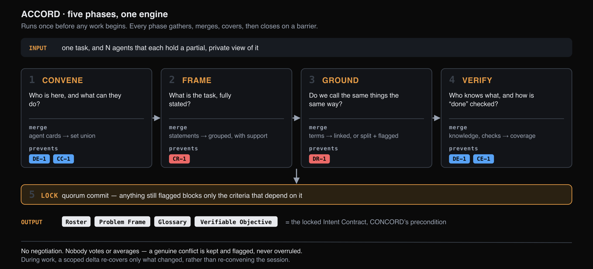

# ACCORD — intent alignment

Establishing shared intent before work begins

Agents that use the same terms are generally assumed to share the same
understanding of them. Where they do not, the mismatch is not detected: the field
names and types match, so no validation fires, and the divergence becomes visible
only in the output.

## Function

ACCORD establishes shared intent prior to the task: which agents are participating,
what problem has been assigned, what the key terms denote, which agent holds which
knowledge, and how correctness will be verified. The L8 transports deliver messages
but do not establish any of these.

The protocol assembles a shared **System Model** by coverage rather than
negotiation. Each agent broadcasts the elements it holds, the protocol merges them
into a single model, and each phase closes only when no element remains divergent
without being recorded as such.

!!! note "Merge operators are computations, not negotiations"
    The protocol defines no propose, object, accept or vote operation. Where two
    agents use different terms for the same referent, the mentions are **linked**;
    where one term carries different meanings, the senses are **split**. Both
    operations are computed over the broadcast contributions.

## Design principles

Three requirements apply to every Cognition Protocol, and are satisfied **by
construction** rather than by observation. They are what distinguishes a protocol
from a prompt or a framework feature.

| Principle | Requirement |
|---|---|
| **Convergence** | The exchange provably reaches a fixed point, or terminates within a stated bound. Neither cycling nor unbounded deliberation is admissible, and a valid result exists at every step — the **anytime** property — so a deadline may truncate a run without invalidating what it has produced |
| **Benefit, certified rather than promised** | The protocol emits a machine-readable artifact recording what was achieved and, where the objective was not met, the precise shortfall |
| **Cost, bounded a priori** | An exact ceiling on rounds, candidate outcomes, agent evaluations and model invocations, reported when the run opens and reconciled against realised cost when it closes |

## Logic — the five phases

ACCORD builds by **coverage, not negotiation**. There is no propose, object, accept
or vote step. Each agent places the pieces it holds on a shared channel, and folding
those pieces together is a computation rather than a conversation: the only judgement
any agent exercises is over its own knowledge.

ACCORD runs **five phases**. Phases 1 to 4 build the shared model and phase 5
commits it. Each of the four building phases runs the same four-beat pattern —
**gather → merge → cover → barrier** — and one engine implements all four, differing
only in what an agent contributes and how contributions combine.

| # | Phase | The question it answers | How contributions merge |
|---|---|---|---|
| **1** | **CONVENE** | Participants and capabilities | Agent cards are merged into a roster. Two queries then run against it: a capability required by the task that no agent covers, and two agents claiming the same exclusive scope. Both are flagged rather than resolved |
| **2** | **FRAME** | Statement of the task | Each agent's restatement is merged, with a **support count** recording how many agents stated each claim independently. A claim made by one agent only is either private knowledge now propagated or a misreading, and is flagged |
| **3** | **GROUND** | Terminology | Mentions denoting the same referent are **linked**; a shared term whose groundings differ is **split** into distinct senses. Where the evidence is insufficient, the protocol requests additional grounding and recomputes |
| **4** | **VERIFY** | Knowledge distribution and acceptance criteria | Produces a directory of which agent holds which knowledge, and acceptance criteria covering the objective's clauses, each assigned to a capable verifier. Any requirement held by no agent is recorded as an explicit gap |
| **5** | **LOCK** | Commit | On quorum, the session emits the **Intent Contract**. Items still flagged block only the criteria that depend on them |

During execution, any agent may raise a scoped update when it introduces a term,
revises its framing, or observes a failed check. The update re-covers only the
affected item rather than re-running the session. Updates are also triggered
automatically at two boundaries: before a delegation, and before final synthesis.

The four artifacts — Roster, Problem Frame, Glossary and Verifiable Objective — form
the **Intent Contract**, which is [CONCORD](../concord/index.md)'s precondition.

## Guarantees

**Convergence.** Merge operations only add; they never retract. The model therefore
grows monotonically over a finite space and reaches a fixed point. The fixed point
is the collective attainable model: requirements held by no agent are reported as
gaps rather than inferred.

**Benefit reporting.** The protocol reports from its own counters, without an
external observability layer: the increment each agent gained over its starting
view, the proportion of the model covered, and the defects surfaced. These are
recorded at a phase barrier rather than reaching execution unrecorded.

**Bounded cost.** Coverage exhibits diminishing returns, so each phase terminates
when a further round no longer yields sufficient coverage per token. Group multicast
keeps the cost of a phase linear in the number of agents rather than quadratic.

## Worked example

An incident-triage case illustrates the failure mode. The inputs contain three
semantic inconsistencies: a service alias (`checkout-service` and
`checkout_service`), one quantity encoded two ways (`error_rate: 0.087` and
`error_rate_percent: 8.7`), and a rollback target distinct from the deployment being
rolled back.

Without the protocol, four defects reach execution, two of which do not appear in
the transcript. The unit mismatch understates impact by approximately two orders of
magnitude and causes a severity check to return LOW, and the agents do not establish
a common definition of completion. A restart is approved, the regression persists,
and the triage cycle repeats.

With the protocol, capabilities are established before the first delegation, the
conflicting completion criteria are recorded as an explicit flag, the three mentions
of the error rate are linked into one concept carrying its unit, the rollback target
is separated from the candidate build, and the missing threshold is recorded as a
gap. The executed action is the correct rollback.

!!! note "Status of these figures"
    The trace is constructed from the application, fixture and agent cards in use,
    and illustrates the mechanism. The counts are worked estimates; measured results
    are reported on the [Evaluation page](../../evaluation/accord.md).

## Out of scope

ACCORD records gaps and conflicts. It does not resolve them.

| Out of scope | Owner |
|---|---|
| **Value conflicts** — for example, two agents asserting different budget figures. Retained and flagged | The task owner, or a further protocol |
| **Decomposition of the work**, where it is not already determined | A further protocol, not currently defined |
| **Selection** among aligned options | **[CONCORD](../concord/index.md)** |

## Handoff to CONCORD

On `INTENT-LOCKED`, ACCORD hands over the Intent Contract — Roster, Frame, Glossary
and Verifiable Objective. Those are exactly CONCORD's preconditions: locked shared
intent and context, grounded terms, the calibration anchors that make satisfaction
scores comparable, and an agreed acceptance basis for comparing outcomes.

!!! note "Rationale for two protocols rather than one"
    The two protocols fail in different ways and are measured differently. ACCORD's
    failure mode is residual ambiguity, reported as missing mass and open flags.
    CONCORD's failure mode is an unreachable satisfaction floor, reported as a named
    agent and a numeric shortfall. A combined protocol would not report either
    clearly.

## Source

**Agreeing on Purpose, Deciding Under Conflict** — L9 + MAS-Lab T3s, Outshift by
Cisco, October 2026.
