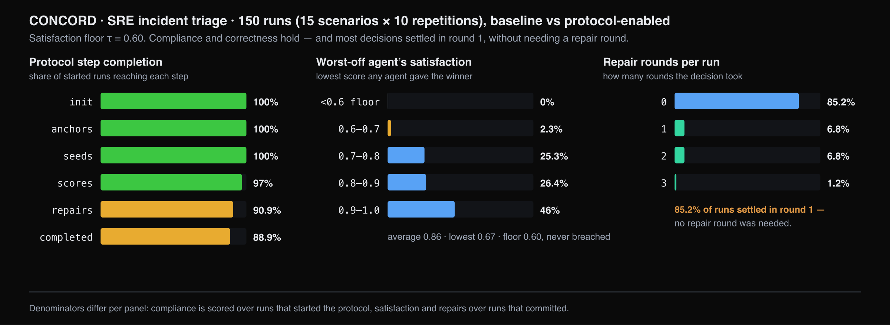
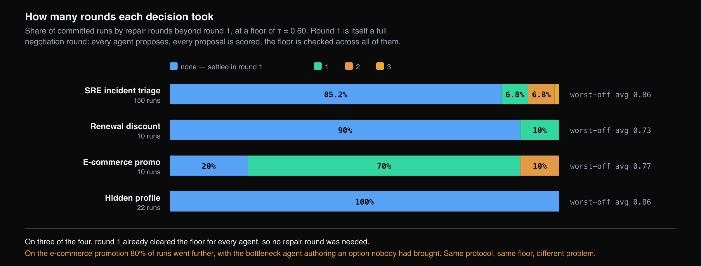

# CONCORD — Evaluation

350 runs across four classes of decision

## Compliance and correctness

150 SRE triage runs at a floor of 0.60, together with a renewal negotiation, an
e-commerce promotion and an information-pooling task.

| | SRE triage | Renewal | E-commerce | Hidden profile |
|---|---|---|---|---|
| Runs | 150 | 10 | 10 | 30 (22 committed) |
| Used all candidates | 97.0% | 100% | 100% | 95.7% |
| Reached a decision | 88.9% | 100% | 100% | 95.7% |
| Agents satisfied | 99.4% | 93.3% | 95.0% | 95.5% |
| Agents not satisfied | 0 | 0 | 0 | 0 |
| Scores consistent with reasoning | 99.3% | 98.4% | 99.3% | 99.2% |
| Worst-off agent, average | 0.86 | 0.73 | 0.77 | 0.86 |

No agent in any committed run finished below the floor on any of the four decisions,
and 98–99% of individual scores were consistent with the reasoning recorded for them.

Inconsistent scores are rare and dispersed: 0.7% of individual scores are
inconsistent, distributed across 6.8% of runs, so an affected run typically contains
a single inconsistent score rather than a consistently divergent agent.

## Cost

| Kind of token | Share of tokens | Share of cost |
|---|---|---|
| Cache read | 78.1% | 15.7% |
| Cache creation | 15.8% | 39.8% |
| Output | 4.0% | 40.3% |
| Fresh input | 2.1% | 4.2% |

A run costs 876K tokens and $0.4352, against a ceiling computed before the run
opens. Token share and cost share are close to inverted: output and cache creation
account for four-fifths of cost while representing a fifth of tokens. Optimisation
against total token count would therefore target the lowest-cost component.

## Threshold calibration

| Repair rounds run | Share of runs |
|---|---|
| 0 — settled in round 1 | 85.2% |
| 1 | 6.8% |
| 2 | 6.8% |
| 3 | 1.2% |

The worst-off agent averages 0.86 against a floor of 0.60, and in 85.2% of runs the
decision settled in round 1.

Those runs did execute the protocol: every agent proposed, every agent scored every
proposal, and the floor was verified across all of them. What they did not require
was a repair round, since no agent was left below the floor and no bottleneck agent
had to author an additional candidate.

!!! note "Interpretation"
    Every certificate issued is valid, and verification that all specialists clear a
    floor is more than the baseline orchestrator performs. However, at this threshold
    the repair operator is exercised in a minority of runs, which is also reflected in
    repair rounds accounting for 7.5% of cost.

    On this workload a floor of 0.80 would leave approximately 27.6% of runs short
    and engage the repair loop; 0.90 would leave approximately 53.4% short.

## Variation across decision types

| Decision | Runs settled in round 1 |
|---|---|
| Hidden profile | 100% |
| Renewal discount | 90% |
| SRE triage | 85.2% |
| E-commerce promotion | 20% |

On the e-commerce promotion, 20% of runs settled in round 1, 70% required one repair
round and 10% required two. The protocol, floor and engine are identical across
cases; the difference is in the decision. Where the specialists represent vendor
systems with incompatible objectives, the opening proposals leave at least one agent
below the floor, and the repair mechanism is engaged.

Cost therefore tracks the difficulty of the decision rather than the length of the
protocol: the repair loop runs in 80% of cases where the roles conflict and in few
cases where they do not.

Round 1 is also the first point at which each agent observes the other proposals and
the reasoning behind them. A settlement in round 1 does not necessarily indicate
that the opening proposals were already compatible; it may indicate that exposure to
the other agents' reasoning changed their evaluations sufficiently to clear the
floor.

## Source

**Agreeing on Purpose, Deciding Under Conflict: Two Protocols for the Agent
Cognitive Layer** — L9 + MAS-Lab T3s, Outshift by Cisco, October 2026.

- [Extended version (PDF, 26 pages)](../blogs/accord-concord-extended.pdf) — the
  full study: motivation, both protocols, the evaluation methodology, the use
  cases, and the results reported here.
