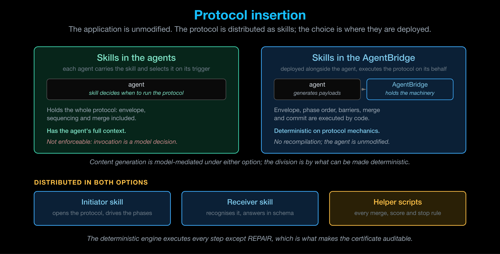

# Cognition Protocols

Cognition Protocols occupy the agent cognitive layer, **L9**, above the L8 agent
transports.

L8 standardizes message envelopes, performatives and interaction patterns; A2A, MCP
and SLIM operate at that layer. It does not define a verifiable shared meaning for
the content those messages carry, nor primitives for coordination and consensus
across a population of agents. Those are the function of L9, which is currently
unpopulated.

## Design requirements

A layer designates a position in an architecture. A protocol specifies an exchange
that can be implemented, executed and measured. That distinction imposes three
requirements that an architectural specification does not. Each Cognition Protocol
satisfies all three by construction rather than by observation.

| Principle | What it requires |
|---|---|
| **Convergence** | The exchange provably reaches a fixed point, or terminates within a stated bound. Neither cycling nor unbounded deliberation is admissible, and a valid result exists at every step — the **anytime** property — so a deadline can truncate a run without invalidating what it has already produced |
| **Benefit, certified rather than promised** | The protocol emits a machine-readable artifact recording what was achieved and, where the objective was not met, the precise shortfall |
| **Cost, bounded a priori** | An exact ceiling on rounds, candidate outcomes, agent evaluations and model calls — reported when the run opens, reconciled against actual spend when it closes |

## Scope of the two protocols

The cognitive failures that design iteration cannot remove fall into two classes,
each addressed by one protocol.

**Absence of shared intent.** The same term used with different meanings,
incompatible task models, routing against an inaccurate capability model, and
outputs produced without a verification step share a common cause: no mechanism
established who is participating, what the problem is, what the terms mean, and how
correctness is to be checked.

**Unreconciled disagreement.** Under an unreconciled-output overlay, the final action
remained correct in most runs while the specialists failed to converge on a shared
solution in **84%** of them. The outcome was not produced by consensus; it was
produced by a single agent acting first.

The two protocols address these in sequence: shared intent is established before work
begins, and the decision is reconciled where roles diverge.

## The two protocols

-   **[ACCORD — intent alignment](accord/index.md)**

    ---

    Runs before the task. Consolidates divergent understandings into one shared
    model by coverage rather than negotiation: who is participating, what the
    problem is, what the terms mean, and how completion is verified. Produces the
    locked **Intent Contract**.

-   **[CONCORD — deciding under conflict](concord/index.md)**

    ---

    Runs during the task, taking the locked contract as input. Selects an outcome
    acceptable to every agent from a set of options that are divergent but each
    correct from its own role, and issues a certificate recording the result, or
    identifies the agent whose floor was not met and the size of the shortfall.

## Handoff between the protocols

On `INTENT-LOCKED`, ACCORD hands over the Intent Contract — Roster, Frame, Glossary
and Verifiable Objective. Those are exactly CONCORD's preconditions: locked shared
intent and context, grounded terms, the calibration anchors that make satisfaction
scores comparable, and an agreed acceptance basis for comparing outcomes.

The scope of each protocol is bounded at both ends. ACCORD does not resolve value
conflicts; CONCORD does not range over role assignments. Decomposition of the work,
where it is not already determined, is outside both and would require a further
protocol, which is not currently defined.

!!! note "Rationale for two protocols rather than one"
    The two protocols fail in different ways and are measured differently. ACCORD's
    failure mode is residual ambiguity, reported as missing mass and open flags.
    CONCORD's failure mode is an unreachable satisfaction floor, reported as a named
    agent and a numeric shortfall. A combined protocol would not report either
    clearly.

## Measured status

Both protocols were evaluated on four dimensions, chosen because they fail
independently: 150 ACCORD runs against a matched baseline, and 350 CONCORD runs
across four classes of decision.

**CONCORD meets all four.** **ACCORD meets three** — its contract is constructed and
used, but goal success is flat against the baseline, which is the one open result.

[:octicons-arrow-right-24: Evaluation](../evaluation/index.md) · [:octicons-arrow-right-24: CONCORD Evaluation](../evaluation/concord.md)

## Scope boundary

Cognition Protocols maintain shared state within a coordination session only. The
following are out of scope:

- **Governance and policy enforcement** — owned by the Cognition Engines area.
- **Persistent memory and knowledge graphs** — owned by the Cognition Fabric.

## Insertion

Adding a protocol to an existing multi-agent system

A Cognition Protocol is designed to be added to a multi-agent system that already
exists, without modifying the application. The architecture is therefore organised
around insertion.

The design assumption is minimal: agents communicate using some messaging mechanism,
whether native to the framework or an external CLI. No further assumption is made
about the application.

The protocol is distributed as **skills** — an initiator skill, a receiver skill, and
the scripts that implement the deterministic portion of the protocol. The
architectural choice is where those skills are deployed, and the second option below
places them in the [AgentBridge](https://shadi.agntcy.org/agentbridge/).

### Deployment of the skills

Two insertion options

| | **Skills in the agents** | **Skills in the AgentBridge** |
|---|---|---|
| **Mechanism** | Each agent carries the skill, whose front matter states the conditions under which it is invoked. The agent selects it | A bridge is deployed alongside the agent and executes the protocol on its behalf. The agent generates payloads; the bridge performs the remaining steps |
| **Invasiveness** | None — no code change | None — no recompilation; the agent is unmodified |
| **Context available** | The agent's own context, in full | The exchange, as it crosses the bridge |
| **Determinism** | Limited — invocation and phase order are both model decisions | Full on protocol mechanics — envelope, sequence, phase barriers, merge and commit are executed by code |
| **Enforcement** | Not enforceable | Enforced by construction |

#### Allocation of determinism

The two options differ in how they divide responsibility. In the bridge
configuration, the bridge holds the protocol machinery — envelope, sequencing,
barriers, merge and commit — and the agent generates the message payloads.

Content generation is model-mediated under either option. The bridge configuration
therefore does not reduce what the agent contributes; it moves the components that
can be made deterministic into code.

#### Selecting an option

**Skills in the agents** is the default for a system under the operator's own
control, and is the configuration used for the measured experiments. The SRE triage
integration is applied as an overlay: a single file adds the initiator skill to the
lead agent and the receiver skill to the five specialists.

No application code, framework or transport is modified, and the baseline remains
runnable as the control arm.

**Skills in the AgentBridge** applies where protocol execution must be guaranteed
independently of a model's decision to invoke it — for example, third-party agents,
or deployments subject to a compliance requirement.

### Protocol packaging

Components common to both options

Both options distribute the same three components. Agents must be able to act in
either role: the **initiator** opens the protocol and sends the first message; the
**receiver** recognises the protocol, answers in schema, and contributes to
resolution. A single agent may hold both roles concurrently.

Each protocol is packaged as one skill carrying the instructions for both roles, the
message schemas, the sequencing rules, and the scripts invoked during the run.

The scripts are a functional requirement rather than a convenience. Constructing
protocol messages from prose instructions alone reduces reliability; the packaging
therefore supplies a tool that formats and sends the message, a script that tallies
scores, and a helper that persists the result.

!!! note "Deterministic execution and auditability"
    CONCORD is implemented on this basis: `REPAIR` is the only step delegated to the
    model, and the remaining steps are executed by a deterministic engine. This is
    what makes the resulting certificate auditable.

In the bridge configuration, sequencing guardrails reject out-of-order messages and
return a correction, which converts the skill instructions into enforced behaviour.

### Portability

One binding per transport

A protocol is portable only if it is specified independently of the transport it
runs over. Each Cognition Protocol is therefore a self-contained definition —
description and trigger conditions, an initiator skill, a participant skill, and JSON
schemas per phase — together with one **transport binding** for each L8 transport it
supports.

A binding covers three concerns:

| Concern | For A2A |
|---|---|
| **Field mapping** — where each protocol field is carried in the L8 envelope | Protocol URI in `message.extensions`, phase and role in `message.metadata`, content in `message.parts` |
| **Discovery** — how a remote agent advertises support | The agent card's extension list and the skill's declared media types |
| **Session correlation** — how multi-turn exchanges are associated | The existing `contextId`, since a protocol run belongs to the conversation that triggered it |

Where all agents are under common control, uniform support can be asserted by
construction and discovery omitted; this is the configuration used in the
experiments. Discovery becomes mandatory once third-party agents participate. At
that point the protocol ceases to be an application-level convention and becomes
interoperable between parties that have no prior arrangement.

## Source

**Agreeing on Purpose, Deciding Under Conflict: Two Protocols for the Agent
Cognitive Layer** — L9 + MAS-Lab T3s, Outshift by Cisco, October 2026. The content
of these pages is drawn from that document.
