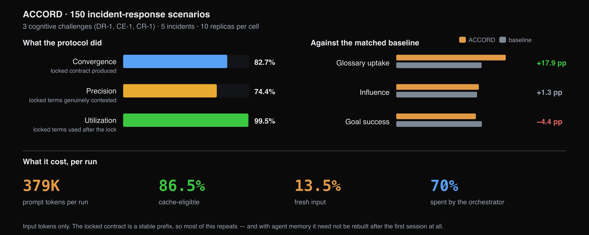

# ACCORD — Evaluation

150 scenarios against a matched baseline

Three cognitive challenges ACCORD targets, five incidents each, ten replicas per
cell, against the same 150 scenarios with the protocol disabled.

## Convergence

A valid locked contract is produced in **124 of 150 runs (82.7%)**. The remaining
runs produce no contract.

Runs that locked averaged 445,090 prompt tokens, against 60,796 for those that did
not — a factor of 7.3. Runs that fail to lock therefore terminate early and consume
a small fraction of the budget.

## Correctness

Measured across 574 locked terms. A term is classified as contested when two agents'
definitions diverge under the same similarity test the protocol uses.

| Metric | Count | % |
|---|---|---|
| Justified — locked and contested | 427/574 | 74.4 |
| Over-selected — locked although the agents already agreed | 147/574 | 25.6 |
| Referenced after lock | 571/574 | 99.5 |

Precision is 74.4%. The over-selected quarter results from an over-inclusive
key-term list rather than from a clustering error: these are terms nominated for the
glossary that the agents were already in agreement on.

Utilization is 99.5%. Three terms across the entire run were locked and not
referenced subsequently, indicating that the glossary is used after it is
constructed.

## Cost

| Metric | Per run |
|---|---|
| Prompt tokens | 379,090 |
| Cache-eligible | 86.5% |
| Fresh input not servable from a prefix cache | 13.5% |
| Share attributable to the orchestrator | 70% |
| LLM calls | 38 |

Three properties of this figure are relevant to deployment. The majority of the
input is cache-eligible, because a locked contract forms a stable prefix repeated
across calls. The contract is constructed once and thereafter carried, so with agent
memory it need not be rebuilt in subsequent sessions. And the cost is concentrated:
the orchestrator accounts for 70% of prompt tokens.

!!! note "Measurement basis"
    Completion tokens are not recorded in these traces, so actual spend is higher.
    Cache-eligibility is computed from the traces as an upper bound on what a prefix
    cache could serve, rather than an observed provider hit rate.

## Benefit

Scored by an LLM judge. A claim is downgraded unless the judge can quote the agent's
exact words.

| Metric | ACCORD | Baseline | Difference |
|---|---|---|---|
| Goal success | 0.589 | 0.633 | −4.4 pp |
| Glossary uptake | 0.810 | 0.631 | +17.9 pp |
| Influence | 0.611 | 0.598 | +1.3 pp |

Glossary uptake — whether an agent demonstrated that a term required definition —
rises 17.9 points, each point quote-backed. Together with 99.5% utilization, this
indicates the protocol performs its specified function.

Goal success is 4.4 points below the baseline. The difference is within the range
where a single judge pass over 124 traces cannot distinguish a regression from
noise, but it is not the improvement the protocol is intended to produce.

Influence — whether the recorded definition changed the agent's subsequent
reasoning, supported by a second quote — rises 1.3 points. Because influence is
computed over the terms present rather than the terms taken up, the conditional
figure is the relevant one: **0.754**. Approximately one agent in four defined a
contested term, recorded that it required definition, and then reasoned without
applying it.

The measurement therefore locates the gap downstream of the contract, at the point
where the shared definition should constrain the agent's subsequent reasoning,
rather than in the five phases that construct it.

## Source

**Agreeing on Purpose, Deciding Under Conflict: Two Protocols for the Agent
Cognitive Layer** — L9 + MAS-Lab T3s, Outshift by Cisco, October 2026.

- [Extended version (PDF, 26 pages)](../protocols/blogs/accord-concord-extended.pdf) — the
  full study: motivation, both protocols, the evaluation methodology, the use
  cases, and the results reported here.
