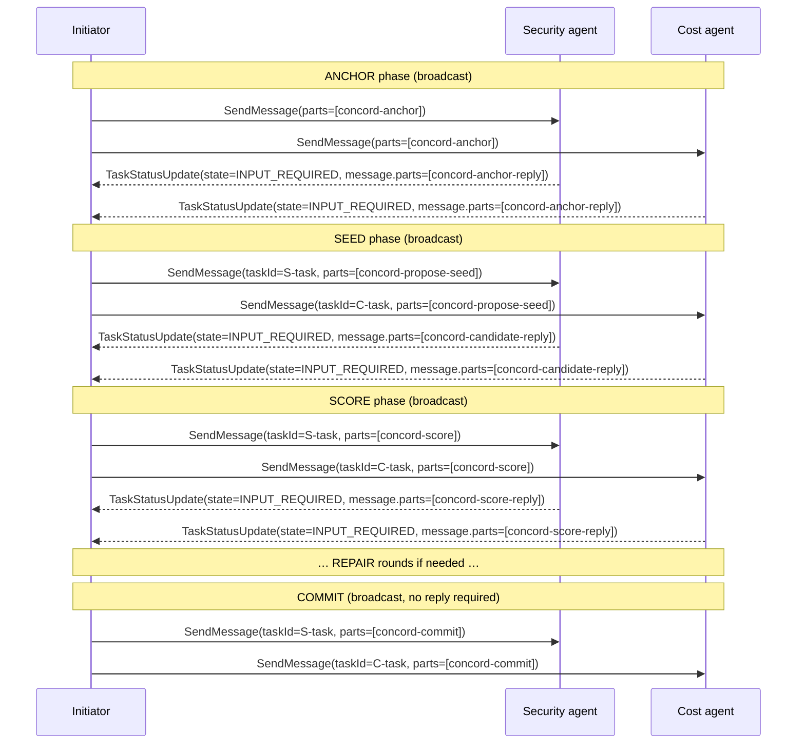

# CONCORD — A2A Transport Binding

<p class="eyebrow">Running CONCORD over the Agent-to-Agent protocol</p>

This document specifies how to run CONCORD over the [Agent-to-Agent (A2A) protocol](https://a2a-protocol.org).
It covers how a CONCORD-capable agent declares its capability in an AgentCard, how CONCORD XML messages
are carried in A2A task turns, and how the multi-turn CONCORD session maps onto A2A task lifecycle.

Protocol semantics — phase sequence, scoring model, termination conditions, and XML message schemas —
are unchanged and defined in the [CONCORD Specification](specification.md).

---

## Media type

All CONCORD messages carried over A2A use the media type:

```
application/vnd.ioc-project.concord+xml
```

A Part carrying a CONCORD message uses the `text` field (or `raw` for binary-safe transport) with
`mediaType` set to this value. The content is the verbatim CONCORD XML document exactly as produced
by `concord_initiator.py` or `concord_receiver.py forge` — no wrapper, no reformatting.

```json
{
  "text": "<concord-anchor>\n  <satisfaction_threshold>0.6</satisfaction_threshold>\n  <x_reject>error rate stays above 40%</x_reject>\n  <x_ideal>error rate returns to 0</x_ideal>\n  <instructions>…</instructions>\n</concord-anchor>",
  "mediaType": "application/vnd.ioc-project.concord+xml"
}
```

---

## AgentCard skill declaration

An agent that implements the **CONCORD receiver** role MUST advertise the following skill in its
AgentCard at `/.well-known/agent.json`:

```json
{
  "id": "concord-receiver",
  "name": "CONCORD Receiver",
  "description": "Accepts CONCORD negotiation messages as a participant. Handles anchor, seed, score, repair, and commit phases.",
  "tags": ["concord", "negotiation", "consensus"],
  "inputModes": ["application/vnd.ioc-project.concord+xml"],
  "outputModes": ["application/vnd.ioc-project.concord+xml"]
}
```

An agent that acts only as an initiator and never as a participant need not advertise this skill.

### Complete AgentCard example

```json
{
  "name": "Security Specialist",
  "description": "Security-domain specialist agent; participates in CONCORD negotiation rounds.",
  "url": "https://example.com/agents/security",
  "version": "1.0.0",
  "defaultInputModes": ["text/plain"],
  "defaultOutputModes": ["text/plain"],
  "skills": [
    {
      "id": "concord-receiver",
      "name": "CONCORD Receiver",
      "description": "Accepts CONCORD negotiation messages as a participant. Handles anchor, seed, score, repair, and commit phases.",
      "tags": ["concord", "negotiation", "consensus"],
      "inputModes": ["application/vnd.ioc-project.concord+xml"],
      "outputModes": ["application/vnd.ioc-project.concord+xml"]
    }
  ]
}
```

---

## Session model

A CONCORD run maps onto A2A as **multi-turn exchanges within a task**: each CONCORD message is an
additional turn on an existing task, not a new task per message. The initiator sends each CONCORD
phase message via `SendMessage` and the participant replies in a `TaskStatusUpdate` with
`state: INPUT_REQUIRED` and the CONCORD reply in the status `message`.

### Task and context reuse

The initiator may already have an active A2A task with each participant — for example, the work
that triggered the CONCORD run. In that case:

- The initiator **SHOULD** send CONCORD messages as additional turns on the existing task by setting
  `taskId` (and `contextId` if known) on the `SendMessage` request.
- The initiator **MUST NOT** create a new task when an active task with that participant already exists
  for the same work.

When no existing task exists with a participant, the initiator creates one per participant with the
first `SendMessage` (omitting `taskId`). The server assigns a `taskId` and `contextId`; the initiator
MUST record both per participant and reuse them in all subsequent turns.

!!! note "contextId is server-assigned"
    `contextId` is assigned by the participant's A2A server, not by the initiator. The initiator
    learns it from the first task response and tracks it per participant. The CONCORD session id (from
    `concord_initiator.py init`) is a separate identifier carried inside the CONCORD XML; it is NOT
    used as the A2A `contextId`.

---

## Message flow

The sequence below covers a two-participant run (security + cost) from ANCHOR through the first SCORE phase.



### Phase-by-phase mapping

| CONCORD phase | A2A operation | Direction | `state` in response |
|---|---|---|---|
| ANCHOR | `SendMessage` (new or existing task) | Initiator → each participant | — |
| ANCHOR reply | `TaskStatusUpdate` | Participant → initiator | `INPUT_REQUIRED` |
| SEED | `SendMessage` (same task) | Initiator → each participant | — |
| SEED reply | `TaskStatusUpdate` | Participant → initiator | `INPUT_REQUIRED` |
| SCORE | `SendMessage` (same task) | Initiator → each participant | — |
| SCORE reply | `TaskStatusUpdate` | Participant → initiator | `INPUT_REQUIRED` |
| REPAIR | `SendMessage` (same task, **bottleneck only**) | Initiator → bottleneck | — |
| REPAIR reply | `TaskStatusUpdate` | Bottleneck → initiator | `INPUT_REQUIRED` |
| COMMIT | `SendMessage` (same task) | Initiator → each participant | — |
| COMMIT acknowledged | (no reply required) | — | workflow-dependent |

---

## Conformance

The following requirements apply to any implementation of this binding.

### Initiator

- MUST send each CONCORD message as a `SendMessage` with exactly one Part carrying
  `mediaType: "application/vnd.ioc-project.concord+xml"`.
- MUST reuse an existing `taskId` and `contextId` when an active task already exists
  for a participant in the same work context.
- MUST record the server-assigned `taskId` and `contextId` from the first task response
  and supply them on all subsequent `SendMessage` calls to that participant in the run.
- MUST send REPAIR messages to exactly one task — the bottleneck agent's task. REPAIR
  MUST NOT be broadcast.
- MUST NOT treat a `TaskStatus.message` that contains no `application/vnd.ioc-project.concord+xml`
  Part as a CONCORD reply. Prose is not a reply; the initiator must re-send the CONCORD message.

### Participant

- MUST advertise the `concord-receiver` skill in its AgentCard as specified above when it
  implements the receiver role.
- MUST accept `SendMessage` requests whose Parts include `mediaType: "application/vnd.ioc-project.concord+xml"`.
- MUST respond to each CONCORD message (ANCHOR, SEED, SCORE, REPAIR) with a
  `TaskStatusUpdate(state=INPUT_REQUIRED)` whose `message.parts` contain the CONCORD reply XML
  with `mediaType: "application/vnd.ioc-project.concord+xml"`.
- **MUST NOT transition an A2A task to a terminal state (`COMPLETED`, `FAILED`, `CANCELED`) while
  a CONCORD session is open on that task.** A CONCORD session is open from the receipt of a
  `concord-anchor` message until a `concord-commit` message is received and acknowledged.
  Terminating the task before COMMIT breaks the negotiation.
- MAY transition the task to any appropriate state after receiving and acknowledging `concord-commit`;
  this binding does not mandate `COMPLETED`.

### Both roles

- The `text` (or `raw`) content of every `application/vnd.ioc-project.concord+xml` Part MUST be
  verbatim CONCORD XML — exactly as produced by `concord_initiator.py` or `concord_receiver.py forge`.
  The XML MUST NOT be paraphrased, reformatted, or reconstructed by hand.

---

## Related

- [Specification](specification.md) — formal CONCORD protocol definition
- [Configuration](configuration.md) — satisfaction threshold and round budget
- [Getting Started](../../getting-started.md) — installing skills across agent harnesses
- [Tutorial: AgentBridge](../../tutorials/agentbridge/index.md) — running CONCORD over A2A via AgentBridge and SLIM
