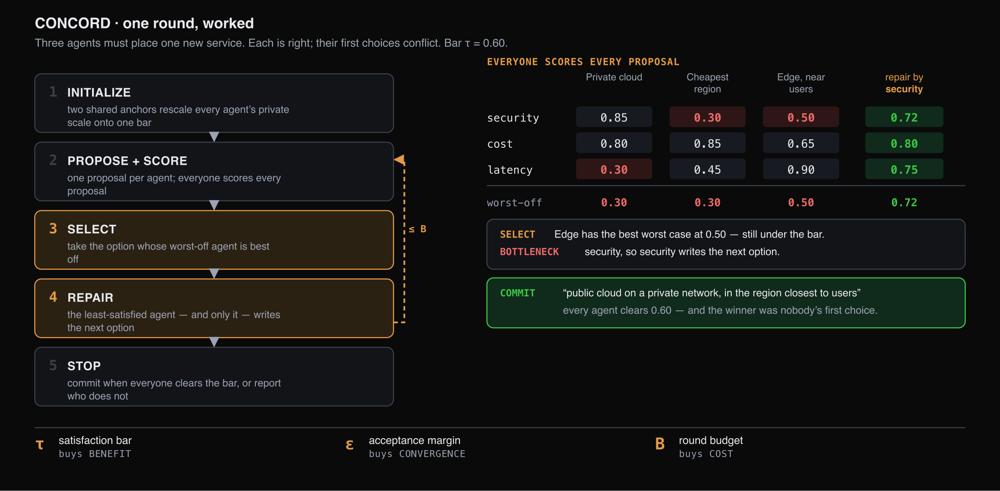
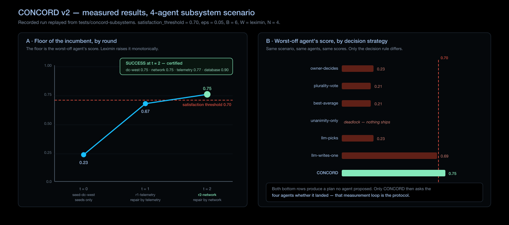

# CONCORD — deciding under conflict

Reaching a decision among divergent but correct positions

Specialist agents frequently produce conflicting recommendations on the same
decision. The conflict arises because each agent reasons correctly from a different
role, not because one of them is in error. CONCORD selects an outcome acceptable to
every agent and issues a certificate recording the result, or identifies the agent
whose floor was not met and the size of the shortfall.

CONCORD was measured over 350 runs across four classes of decision. No agent in any
committed run finished below the satisfaction floor.

## Problem statement

A security agent, a cost agent and a latency agent will rank the same remediation
differently, and each ranking is correct from its own role. Residual conflict of
this kind is structural rather than a fault.

There is no ground truth to converge on. There is a decision to be taken, and an
agent that will be least well served once it is taken.

The standard aggregation rules each discard information required to handle this
case:

| Rule | Information discarded |
|---|---|
| **Majority vote** | Preference intensity. A position of the form "my third choice, but acceptable" cannot be expressed |
| **Averaging** | Produces a preference that no agent holds |
| **Orchestrator decides** | One role's view determines the outcome, without a record of the trade-off |
| **Free-form deliberation** | In practice the outcome, since LLM populations converge under conformity pressure rather than on the merits |

Agreement reached under conformity pressure is externally indistinguishable from
agreement reached on the merits, which is why the protocol requires satisfaction to
be stated numerically and exchanged.

## Logic — the five phases

CONCORD represents satisfaction as explicit, numeric and exchanged values, and
requires a measured improvement before the standing answer is replaced.

Each agent scores candidate outcomes on a scale pinned to two shared reference
points — one rejected, one ideal — so a score means the same degree of
role-satisfaction for every agent rather than each using its own private units.
Calibration against shared reference points is what makes scores comparable across
agents. Aggregating uncalibrated scores would assume interpersonal comparability of
utility, which social choice theory treats as a substantive assumption rather than a
technical one.

A run is governed by three parameters:

| Control | Definition | Property it establishes |
|---|---|---|
| **Satisfaction floor** | The level below which an outcome is not acceptable to a role | Benefit |
| **Acceptance margin** | The minimum improvement required to replace the standing answer | Convergence |
| **Round budget** | An upper bound on the number of rounds | Cost |

One further choice determines how candidates clearing the floor are ranked. The
default raises the least-satisfied agent first.

### The phases

| Phase | What it does |
|---|---|
| **1 INITIALIZE** | Two shared anchors rescale every agent's private scale onto one bar, so a floor of 0.60 denotes the same degree of role-satisfaction for every agent |
| **2 PROPOSE + SCORE** | One proposal per agent; every agent scores every proposal. This is a full negotiation round in its own right |
| **3 SELECT** | Take the option whose worst-off agent is best off |
| **4 REPAIR** | The least-satisfied agent — and only it — writes the next option, raising its own satisfaction while keeping the others above the floor |
| **5 STOP** | Commit when every agent clears the bar, or report which agent does not and by how much |

Phases 2 to 5 repeat until the floor is cleared or the round budget is exhausted.
From round 2 onward exactly one new candidate appears per round, authored by the
**bottleneck agent**: the agent least satisfied by the current leading candidate.

The satisfaction floor is fixed for the duration of a run and does not relax when it
binds. Where no outcome clears the floor, the protocol returns the shortfall rather
than lowering the threshold, leaving the decision to adjust it with the operator.

## Position

CONCORD performs preference-aggregation consensus rather than belief-state
consensus. The consensus primitives usually associated with this layer — voting,
threshold signatures, state replication — establish agreement on one interpretation
of a global state. CONCORD addresses agreement on a decision where intent and
context are already established and the remaining conflict is structural.

Its scope is limited to selecting an outcome once the other coordination questions
are settled.

## Guarantees

Three properties hold by construction rather than as observed behaviour.

| Property | Status | Statement |
|---|---|---|
| **Convergence** | Unconditional | The leading candidate is replaced only by a strict improvement for the least-satisfied agent, and the candidate pool is finite, so the protocol cannot revisit a position it has left and cannot cycle. It terminates within the round budget |
| **Cost** | Bounded in advance | The ceiling on rounds, candidates, agent evaluations and model calls is computable before the run opens and is reconciled against actual spend when it closes. For five agents and a six-round budget the worst case is 6 rounds, 11 candidates, 55 agent evaluations and 51 model calls |
| **Benefit** | Certified when achieved | A successful return establishes that every agent is at or above the floor |

The protocol is **anytime**: a valid answer exists at every round, so an external
deadline can terminate a run without invalidating what it has produced.

### Return values

A run terminates in one of two states. **Success** records that every agent in the
negotiating set is at or above the floor — not a majority and not an average — with
the supporting arithmetic available for audit. **Best effort** records that the round
budget was exhausted, and identifies which agent is below the floor and by what
margin.

Success is not guaranteed in advance because it requires two conditions: an
acceptable option must exist, which is a property of the problem, and the
least-satisfied agent must be able to construct it, which is a property of the model
and is an empirical question.

!!! warning "Certification covers agreement, not correctness"
    A certified outcome is one that every role finds acceptable. It is not evidence
    that the decision is correct. Where a ground truth exists, correctness must be
    reported alongside certification.

## Communication regimes

The communication graph is determined by the MAS design, and the protocol operates
on whatever graph is given.

On a **group channel**, every agent receives every exchange directly. On a
**predefined workflow**, scores traverse the paths the MAS already provides,
relaying through the agents that connect the remainder. Both regimes reach the same
certified outcome and converge in the same number of accepted moves; they differ in
hop count and message volume.

Where the graph does not connect the whole negotiating set, the certificate is
narrowed to the subset it covers, and the uncovered agents are reported as unknown.

## Worked example

Four subsystem owners with partial visibility

Four agents respond to a region-wide incident, each owning one subsystem. The
customer-visible facts are agreed between them. What is not agreed, and what no
single agent can establish, is which subsystem is the binding constraint.

Each opening proposal is therefore correct from its own role and unacceptable from
another. The telemetry agent will not endorse an irreversible action the group
cannot verify; the database agent is protecting write integrity; the region owner
owns the region the others propose to move traffic out of. The disagreement concerns
which facts each agent can observe, so further discussion does not resolve it.

The floor rises **0.23 → 0.67 → 0.75**, clearing the 0.70 threshold after two repair
rounds of a six-round budget — 6 candidates against a bound of 10, and 24
evaluations against a bound of 40. The selected plan was authored by the agent that
was least satisfied at the time; it was not present when the run began and was no
agent's first choice.

### Comparison against other decision rules

Identical evidence, identical agents and identical scores, varying only the decision
rule.

| Strategy | Worst-off score | Result |
|---|---|---|
| **CONCORD** | **0.75** | Clears the floor for all four |
| LLM writes a plan | 0.69 | Fails for one agent |
| LLM picks a plan | 0.23 | Fails for three |
| Owner decides | 0.23 | Fails for three |
| Best average | 0.21 | Fails for two |
| Majority vote | 0.21 | Fails for two |
| Unanimity required | — | Deadlock; no outcome committed |

An LLM given every plan and every score produced a plan that missed one agent's
floor by 0.01. The measured difference between that result and CONCORD's is
attributable to the verification step that follows synthesis rather than to the
synthesis itself.

## Source

**Agreeing on Purpose, Deciding Under Conflict** — L9 + MAS-Lab T3s, Outshift by
Cisco, October 2026.

---

- [Getting Started](../../getting-started.md)
- [Configuration](configuration.md)
- [Specification](specification.md)
- [Evaluation](../../evaluation/concord.md)
