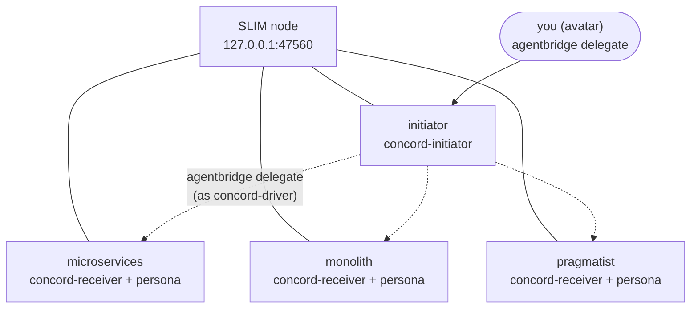

# Installation

<p class="eyebrow">Adding a Cognition Protocol to an existing multi-agent system</p>

A Cognition Protocol is designed to be added to a multi-agent system that already
exists, without modifying the application. The design assumption is minimal: agents
communicate using some messaging mechanism, whether native to the framework or an
external CLI. No further assumption is made about the application.

The messaging mechanism can be anything that lets one agent send a message to another
and read its reply. Two concrete setups are described [below](#running-over-agentbridge):
[Agntcy AgentBridge](https://github.com/agntcy/shadi), which makes independent coding
harnesses talk over a message bus, and [Claude Code agent teams](#running-with-claude-code-agent-teams),
which is the quickest way to try a protocol in your local Claude Code.

## Coding harnesses, Claw-like agents, and Agntcy AgentBridge

Each protocol is distributed as **skills** — an initiator skill, a receiver skill,
and the scripts that implement the deterministic portion of the protocol. Install the
initiator on any agent that may trigger the protocol and the receiver on every agent
that may be asked to take part. An agent can carry both.

### Getting the skills

=== "Claude Code marketplace"

    For Claude Code, the recommended install path is the plugin marketplace. One command
    registers this repository as a marketplace, and one more installs each protocol.

    **Install both skills (both roles):**

    ```bash
    claude plugin marketplace add ioc-project/cognition-protocols
    claude plugin install concord@cognition-protocols
    claude plugin install accord@cognition-protocols
    ```

    Each protocol plugin contains two skills — `concord-initiator` and `concord-receiver`
    (or `accord-initiator` and `accord-receiver`). Their activation conditions are precise:
    the initiator skill only activates when the agent is orchestrating a protocol run;
    the receiver skill only when the agent receives a protocol message. An agent carrying
    both will activate the right skill automatically based on which messages it receives.

    **Install for a single role:**

    The plugin marketplace does not support per-skill enable/disable (Claude Code's
    `skillOverrides` setting applies only to `.claude/skills/` directory skills, not to
    plugin skills). If an agent plays only one role and you want to reduce context cost,
    install only the skill you need via the skills directory — see [Installing a skill](#installing-a-skill) below.

=== "AI Catalog"

    Skills are published to an [AI Catalog](https://ioc-project.github.io/cognition-protocols/ai-catalog.json) and can be installed with the [`ai-catalog` CLI](https://github.com/Agent-Card/ai-catalog-cli).

    Register the catalog once:

    ```bash
    ai-catalog catalog add ioc-protocols https://ioc-project.github.io/cognition-protocols/ai-catalog.json
    ```

    Then pull and install a skill. Skills are distributed as zip archives, so unzip after pulling:

    ```bash
    ai-catalog pull urn:air:ioc-project:skill:concord-initiator -o /tmp/skill-download/
    unzip /tmp/skill-download/concord-initiator.zip -d /tmp/skill-download/
    mv /tmp/skill-download/concord-initiator ~/.claude/skills/
    ```

    Repeat for each skill you need (`concord-receiver`, `accord-initiator`, `accord-receiver`).

=== "GitHub releases"

    Download individual skill zips from the
    [GitHub releases page](https://github.com/ioc-project/cognition-protocols/releases), then unzip and copy the skill folder into the harness's skills directory.

### Installing a skill

Copy (or symlink) each skill folder into the harness's skills directory.

| Harness | User-wide | Project only |
|---|---|---|
| Claude Code | `~/.claude/skills/` | `.claude/skills/` |
| Codex CLI | `~/.codex/skills/` | `.agents/skills/` |
| Other agentskills-compatible | see harness docs | same |

Symlinks stay updated on `git pull`. Agents running in separate processes or
containers each need their own copy of their skill, including its `scripts/` folder.

## Running over AgentBridge

[AgentBridge](https://github.com/agntcy/shadi) (`agentbridge` and `shadictl`, from the
`agntcy/shadi` repository) registers each coding harness instance as a live service on a
[SLIM](https://github.com/agntcy/slim) message bus and lets one instance send a prompt to
another with `agentbridge delegate`. It is used purely as process launcher and transport:
the protocol is unchanged, and the initiator uses `agentbridge delegate` as its delegation
primitive, where an in-process orchestrator would use its sub-agent tool.

The example below runs CONCORD across four independent Claude Code processes: one
initiator and three receivers with conflicting criteria (`microservices`, `monolith`,
`pragmatist`) that must agree on how to build a notification service.



### Prerequisites

- Claude Code, with `ANTHROPIC_API_KEY`, `CLAUDE_CODE_OAUTH_TOKEN` or `ANTHROPIC_AUTH_TOKEN`
  set in the shell that registers the agents. The sandbox that wraps each agent cannot
  read your keychain login.
- `agentbridge` and `shadictl`, and `slimctl` for the SLIM node, on your `PATH`:

    ```bash
    brew tap agntcy/shadi https://github.com/agntcy/shadi.git
    brew install shadictl agentbridge
    ```

!!! warning "Unreleased fixes"
    Running several Claude Code instances side by side needs fixes that are not in an
    AgentBridge release yet, such as an explicit per-instance agent id and a fresh
    Claude session for every incoming message. Until they are released, build `agentbridge`
    and `shadictl` from the `agntcy/shadi` branches that carry them.

### One directory per agent

`claude` discovers skills and personas from its working directory, so each agent gets its own
directory. The skills come from [Getting the skills](#getting-the-skills); the persona is a
`CLAUDE.md` that holds the criteria that agent rates candidates against.

```bash
for role in initiator microservices monolith pragmatist; do
  mkdir -p agents/$role/.claude/skills
done

SKILLS=~/repos/cognition-protocols/protocols/concord/skills
ln -s $SKILLS/concord-initiator agents/initiator/.claude/skills/
for role in microservices monolith pragmatist; do
  ln -s $SKILLS/concord-receiver agents/$role/.claude/skills/
done
```

Write each role's criteria in `agents/<role>/CLAUDE.md`. The initiator's `CLAUDE.md` should
tell it to keep every file it writes under `./run/`.

### Identity and profiles

AgentBridge authenticates members of the bus with DIDs, not shared secrets. Derive them for
all participants from one fixed seed with `shadictl derive-agent-identity`, and export
`SHADI_SLIM_AUTH=did`, `SLIM_HUMAN_SEED` and the comma-separated `SLIM_MEMBER_DIDS`.
Include these identities:

| Identity | Used for |
|---|---|
| `avatar` | You: the kickoff `agentbridge delegate` call from your terminal |
| `concord-driver` | The initiator's own outbound calls to the receivers (the bus allows one active session per identity, so it cannot reuse `avatar` or `initiator`) |
| `initiator`, `microservices`, `monolith`, `pragmatist` | The four registered agents |

Each role also needs an AgentBridge profile (`--tool <role>`) that launches `claude` in
print mode and sets the agent id. For the initiator, disallow the in-process `Task` tool so
that it can only delegate over the bus:

```json
{
  "id": "initiator",
  "bin": "claude",
  "execute": {
    "args": ["--print", "--output-format", "json",
             "--permission-mode", "bypassPermissions",
             "--disallowedTools", "Task",
             "--", "{prompt}"]
  }
}
```

Point `AGENTBRIDGE_PROFILES_DIR` at the directory holding these profiles. The full profiles,
with session handling and temp-directory pinning, are in the reference setup linked at the end of this section.

### Start the mesh

Use one terminal per process so that each agent's traffic is visible. Every terminal needs the
exported environment above.

```bash
# 1. the message bus (needs mTLS certificates for the SLIM node)
slimctl slim start -c slim-node.yaml

# 2. the four agents, each from its own directory
cd agents/initiator && agentbridge register --tool initiator \
  --command "$PWD" --slim-endpoint 127.0.0.1:47560
# ... and the same in agents/microservices, agents/monolith, agents/pragmatist
```

Wait until every agent prints `ready — listening on ...`. Wrapping `agentbridge register` in
`shadictl` (with `--net-allow` for the bus and `api.anthropic.com`) runs each agent
sandboxed, and is the safer choice whenever the bus is reachable beyond `127.0.0.1`.

### Run the protocol

Hand the initiator its goal with `delegate`, as `avatar`. Give it the scenario **inline**:
a registered Claude Code instance cannot read files outside its own directory.

```bash
agentbridge delegate "$(cat kickoff.md)" \
  --to initiator --agent-id avatar --endpoint 127.0.0.1:47560
```

`kickoff.md` contains the scenario (the candidate schema and the anchors for the decision), and
tells the initiator to load `concord-initiator`, initialise it with
`--agents microservices,monolith,pragmatist`, and drive it to a certificate, reporting the
certificate verbatim. The initiator runs the skill's script itself. Every message the script
asks for is a real `agentbridge delegate` call to a live receiver, so a run takes minutes
rather than seconds: the call budget printed by `init` is `3N + (N+1)·B` (up to 41 calls at
`N=3` agents and `B=8` rounds).

The initiator's state file in `./run/` holds the authoritative certificate: `COMMIT` with
every agent at or above the satisfaction threshold, or `BEST_EFFORT` with the agent that
fell short.

!!! tip "Reference setup"
    The ready-made scripts for all of the above (certificate generation, one script per
    process, a one-command `demo.sh`, and recorded runs) are in the `concord/testing/agentbridge`
    folder of `ioc-core-l9`.

## Running with Claude Code agent teams

To try a protocol on your own machine without a message bus, use the experimental
agent teams feature of Claude Code. A lead
agent creates a team of teammates and exchanges messages with them using `SendMessage`.
The lead plays the initiator, the teammates play the receivers, and the protocol is unchanged.
This is the same notification-service decision as in the AgentBridge example.

Agent teams work only on a single machine, with no network between the agents, and only
with Claude Code. Use AgentBridge when agents must run in separate processes, containers or
harnesses.

### Prerequisites

- Claude Code, logged in, with `CLAUDE_CODE_EXPERIMENTAL_AGENT_TEAMS=1` in the environment
  of the session that acts as the lead.
- The protocol skills from [Getting the skills](#getting-the-skills).

### Set up the working directory

Create an empty directory outside any repository, with the skills in `.claude/skills/`, one persona
file per teammate in `personas/` (the same criteria you would put in each AgentBridge
`CLAUDE.md`), and an empty `run/` for the lead's files:

```bash
WORK=/tmp/teams-concord
mkdir -p $WORK/.claude/skills $WORK/personas $WORK/run
SKILLS=~/repos/cognition-protocols/protocols/concord/skills
cp -R $SKILLS/concord-initiator $SKILLS/concord-receiver $WORK/.claude/skills/
# write personas/microservices.md, personas/monolith.md, personas/pragmatist.md
```

### Kick off the lead

Start Claude Code in that directory with a prompt that has three parts:

1. **The task**: the decision the team must make, stated once and verbatim.
2. **The protocol**: tell the lead to use the `concord-initiator` skill and its script
   (`--state ./run/...` on every call), with the receivers named exactly as the teammates.
3. **Team setup and messaging rules**: tell the lead to create a team with one teammate per
   role, each told to read its own persona file, to answer only the lead with `SendMessage`, and
   never to message another teammate. Wherever the skill says to send a message to an agent,
   the lead sends it with `SendMessage`, one teammate at a time, waits for the reply, and
   uses that reply text as the agent's answer. It must never write a teammate's reply itself.

```bash
cd $WORK && CLAUDE_CODE_EXPERIMENTAL_AGENT_TEAMS=1 claude "$(cat kickoff.md)"
```

The session stays open, so you can follow the team while the protocol runs. The lead ends with
the certificate, and its files, including the script's state file, are in `run/`. `/tmp` can be cleared on a
reboot, so copy `run/` somewhere safe if you want to keep it.

!!! tip "Reference setup"
    A `setup.sh` that builds this directory, the three personas and the exact kickoff prompts
    (a no-protocol baseline, then ACCORD followed by CONCORD) are in the
    `concord/testing/agent-teams` folder of `ioc-core-l9`, next to the AgentBridge setup.

## Agents whose code you control

Frameworks such as LangChain, Google ADK, and others support agentskills-compatible
skill loading. If your agent framework supports skills, use the same skills above.

If skills are not available, implement the protocols directly against their
specifications.

