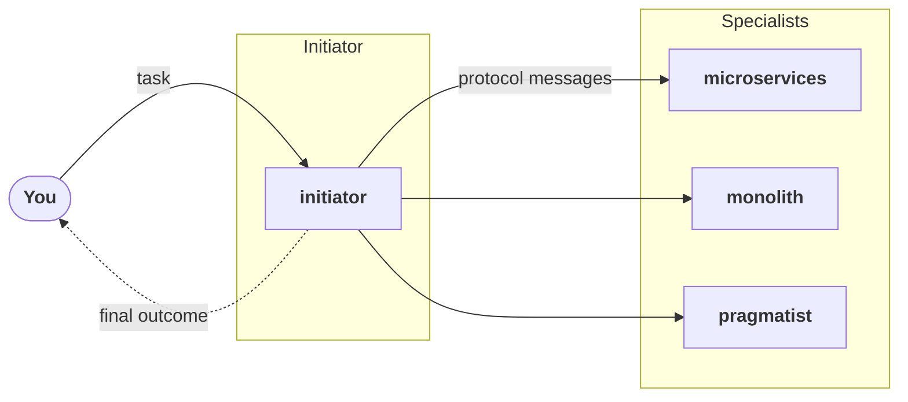

# Coding Agent Team

<p class="eyebrow">A team of coding agents settling an architecture decision</p>

A team of coding agents has to settle how to build a feature. Three specialists disagree, and
an initiator coordinates them with a Cognition Protocol. Run it with the
[Claude Agent Teams tutorial](../../index.md).

## The task

> We are adding a new notification-delivery capability to the product (a notification
> service): users can opt in to email / push / SMS notifications for events raised across
> several existing subsystems. The team must develop it, and needs one decision on how to
> build it that everyone can live with.

## The agents

| Agent | Role |
|---|---|
| `initiator` | Starts the protocol and coordinates the specialists. |
| `microservices` | Advocates a standalone notifications service with its own datastore and deploy pipeline. |
| `monolith` | Advocates a notifications module inside the existing monolith. |
| `pragmatist` | Owns on-call load and infrastructure cost, with no architectural preference. |



The three specialists also use the words *service*, *deployment* and *outage* in different
senses, which is what a protocol has to bring to the surface before it can reconcile them.

## The prompt

The prompt is the whole implementation of this example. It gives the initiator the task and
the role of each specialist, tells it which protocol skill to use, and sets up the team and the
messaging rules. It follows the [template](../../index.md#4-prompt-the-initiator-with-a-template)
of the tutorial, filled in for this example and for the `concord` protocol; for `accord`,
replace `concord-initiator` with `accord-initiator`.

[:material-download: Download prompt.md](prompt.txt){ download="prompt.md" }

??? example "prompt.md"

    ```text
    --8<-- "tutorials/agent-teams/examples/coding-agent-team/prompt.txt"
    ```

## Running it

Follow the [tutorial](../../index.md) with this prompt: install the protocol plugin, then start
Claude Code with the prompt.

```bash
mkdir -p ~/agent-team/run && cd ~/agent-team
curl -fsSL https://ioc-project.github.io/cognition-protocols/tutorials/agent-teams/examples/coding-agent-team/prompt.txt -o prompt.md
claude plugin install concord@cognition-protocols --scope project
CLAUDE_CODE_EXPERIMENTAL_AGENT_TEAMS=1 claude "$(cat prompt.md)"
```
