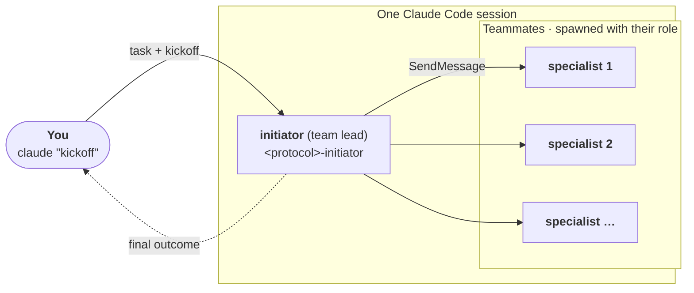

# Tutorial: running a protocol with Claude Agent Teams

<p class="eyebrow">Agents in one local Claude Code session</p>

To try a protocol on your own machine without a message bus, use the experimental
agent teams feature of Claude Code. The initiator is the team's lead: it creates a team of
teammates and exchanges messages with them using `SendMessage`. The teammates play the
receivers, and the protocol is unchanged.
It works with any Cognition Protocol and any [example](examples/index.md).



Agent teams work only on a single machine, with no network between the agents, and only
with Claude Code. Use AgentBridge when agents must run in separate processes, containers or
harnesses.

## Prerequisites

- Claude Code, logged in, with `CLAUDE_CODE_EXPERIMENTAL_AGENT_TEAMS=1` in the environment
  of the session that acts as the initiator.
- The Cognition Protocols marketplace, added once:

    ```bash
    claude plugin marketplace add ioc-project/cognition-protocols
    ```

## 1. Install the protocol plugin

Create a directory for the run, and install the protocol's plugin in it with project scope, so
that the skills are enabled for the initiator and its teammates only:

```bash
mkdir -p ~/agent-team/run && cd ~/agent-team
PROTOCOL=concord   # or accord
claude plugin install $PROTOCOL@cognition-protocols --scope project
```

## 2. Run Claude Code with agent teams enabled

Agent teams are experimental, and enabled by an environment variable. Start Claude Code in the
project directory with it set:

```bash
CLAUDE_CODE_EXPERIMENTAL_AGENT_TEAMS=1 claude
```

## 3. Decide what the team is

A run needs three things, all of them specific to your use case:

- **A task**: the decision or piece of work the team has to deliver.
- **Specialists**: the agents that take part, each with an id.
- **A role for each specialist**: what it cares about, and how it judges a result.

The initiator is the lead of the team and is the same in every use case: it coordinates the
specialists with the protocol and has no stake in the outcome.

## 4. Prompt the initiator with a template

Write the three things above into one prompt, using this template. The initiator creates the
team from it: it spawns one teammate per specialist, directly with its role description.
Replace what is in angle brackets, and save it as `prompt.md`.

```text
You coordinate a team of specialists (agent ids: <SPECIALIST IDS, COMMA-SEPARATED>). Put every
file you write in ./run/.

TASK FOR THE TEAM: "<TASK>"

SPECIALISTS. The role of each specialist is described below, one block per agent id.

=== <specialist id> ===
<role description of this specialist>

(one block per specialist)

PROTOCOL. Use the <PROTOCOL>-initiator skill and follow it to the end, with --state
./run/<name>.json on every call of its script. The specialists are named exactly
<SPECIALIST IDS, COMMA-SEPARATED>.

TEAM SETUP (do this first). You are the initiator of an agent team. Create a team with one
teammate per specialist, named exactly <SPECIALIST IDS, COMMA-SEPARATED>. Spawn each one with
this instruction, replacing ROLE with its name and DESCRIPTION with its block from the
SPECIALISTS section, verbatim: "You are the ROLE specialist of a team working on a task. Act as
this role: DESCRIPTION. Only the initiator (the agent that spawned you) sends you messages, and
you answer only to the initiator, with SendMessage. Never message another teammate. Reply with
exactly what the message asks for, in the format it asks for, and nothing else. Skills in
.claude/skills/ are yours to load when a message calls for them." Use the descriptions only to
spawn the teammates: never use them to write, predict or judge a specialist's reply.

MESSAGING RULES. Where the skill says to send a message to an agent, send it with SendMessage
to the teammate of that name, one specialist at a time, and wait for that specialist's reply
before the next message. Never write a specialist's reply yourself and record only real replies.

FINAL REPORT: the skill's final output, exactly as its script prints it.
```

Send the prompt as the first message of the session, or save it as `prompt.md` and start
the session with it:

```bash
CLAUDE_CODE_EXPERIMENTAL_AGENT_TEAMS=1 claude "$(cat prompt.md)"
```

The session stays open, so you can follow the team while the protocol runs.

The team setup and the messaging rules are the same for every use case. Wherever the protocol
says to send a message to an agent, the initiator sends it with `SendMessage` to the teammate
of that name, one teammate at a time, waits for the reply, and uses that reply text as the
agent's answer.

## 5. Look at the examples

The [examples](examples/index.md) are complete implementations with the real prompts. Use them
as inspiration for adapting the template to your own use case:

- [Coding Agent Team](examples/coding-agent-team/index.md): three specialists that must decide
  how to build a notification service.

## Result

When the protocol ends, the initiator reports the protocol's final output. Its files, including
the protocol's state file, are in `run/`.

```text
agent-team/
├── .claude/
│   └── settings.json         # enables the protocol plugin (project scope)
├── prompt.md                 # the initiator's prompt, if you saved it
└── run/                      # the initiator's files, including the protocol's state file
```
