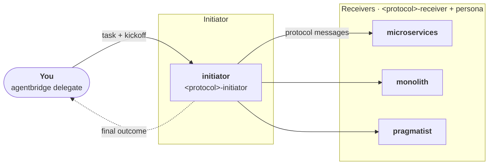

# Tutorial: running a protocol over AgentBridge

<p class="eyebrow">Agents on separate processes, joined by AgentBridge</p>

<p class="eyebrow">Agents on separate processes, joined by AgentBridge</p>

[AgentBridge](https://github.com/agntcy/shadi) ([`agentbridge`](https://github.com/agntcy/shadi/tree/main/crates/agentbridge_cli)
and [`shadictl`](https://github.com/agntcy/shadi/tree/main/crates/shadictl), from the
[`agntcy/shadi`](https://github.com/agntcy/shadi) repository) registers each coding harness instance as a live agent and lets
one instance send a prompt to another with `agentbridge delegate`. Agents talk
[A2A](https://a2a-protocol.org), either natively or over a [SLIM](https://github.com/agntcy/slim)
message bus. It is used purely as process launcher and transport: the protocol is unchanged,
and the initiator uses `agentbridge delegate` as its delegation primitive, where an in-process
orchestrator would use its sub-agent tool.

Any Cognition Protocol can run this way. The example below uses four independent Claude Code
processes: one initiator and three receivers with different roles (`microservices`, `monolith`,
`pragmatist`) that must reach a decision on how to build a notification service. It uses the
SLIM transport; the node and identity steps are specific to it.



## Prerequisites

- Claude Code, with `ANTHROPIC_API_KEY`, `CLAUDE_CODE_OAUTH_TOKEN` or `ANTHROPIC_AUTH_TOKEN`
  set in the shell that registers the agents. The sandbox that wraps each agent cannot
  read your keychain login.
- `agentbridge` and `shadictl` from [`agntcy/shadi`](https://github.com/agntcy/shadi), on your `PATH`. On macOS:

    ```bash
    brew tap agntcy/shadi https://github.com/agntcy/shadi.git
    brew install shadictl agentbridge
    ```

- `slimctl` from [`agntcy/slim`](https://github.com/agntcy/slim), which starts the SLIM node. On macOS:

    ```bash
    brew tap agntcy/slim https://github.com/agntcy/slim.git
    brew install slimctl
    ```

!!! note "Other operating systems"
    The commands above are for macOS. On another system, follow the installation instructions
    in each repository instead: [`agntcy/shadi`](https://github.com/agntcy/shadi) for
    `agentbridge` and `shadictl`, and [`agntcy/slim`](https://github.com/agntcy/slim)
    (see also the [SLIM documentation](https://docs.agntcy.org/slim/slim-howto/)) for `slimctl`.

## One directory per agent

`claude` discovers skills and personas from its working directory, so each agent gets its own
directory. Register the Cognition Protocols marketplace once, then install the protocol's plugin
in each agent's directory with project scope, so that it is enabled for that agent only. The
persona is a `CLAUDE.md` that describes the role that agent plays.

```bash
claude plugin marketplace add ioc-project/cognition-protocols

PROTOCOL=<protocol>   # a protocol plugin, e.g. accord or concord
for role in initiator microservices monolith pragmatist; do
  mkdir -p agents/$role
  (cd agents/$role && claude plugin install $PROTOCOL@cognition-protocols --scope project)
done
```

Each plugin carries both the initiator and the receiver skill. Their activation conditions
are precise, so the initiator skill only activates on the agent that starts the protocol and
the receiver skill on the agents that receive its messages.

Write each role's description in `agents/<role>/CLAUDE.md`. The initiator's `CLAUDE.md` should
tell it to keep every file it writes under `./run/`.

## Identity and profiles

AgentBridge authenticates members of the bus with DIDs, not shared secrets. Derive them for
all participants from one fixed seed with `shadictl derive-agent-identity`, and export
`SHADI_SLIM_AUTH=did`, `SLIM_HUMAN_SEED` and the comma-separated `SLIM_MEMBER_DIDS`.
Include these identities:

| Identity | Used for |
|---|---|
| `avatar` | You: the kickoff `agentbridge delegate` call from your terminal |
| `driver` | The initiator's own outbound calls to the receivers (the bus allows one active session per identity, so it cannot reuse `avatar` or `initiator`) |
| `initiator`, `microservices`, `monolith`, `pragmatist` | The four registered agents |

Each role also needs an AgentBridge profile (`--tool <role>`) that launches `claude` in
print mode and sets the agent id. For the initiator, disallow the in-process `Task` tool so
that it can only delegate over the bus:

```json
{
  "id": "initiator",
  "bin": "claude",
  "execute": {
    "args": ["--print", "--output-format", "json",
             "--permission-mode", "bypassPermissions",
             "--disallowedTools", "Task",
             "--", "{prompt}"]
  }
}
```

Point `AGENTBRIDGE_PROFILES_DIR` at the directory holding these profiles. The full profiles,
with session handling and temp-directory pinning, are in the reference setup linked at the end of this section.

!!! note "Why the agents run sandboxed"
    With AgentBridge, agents are reached over the network: any member of the bus can send a
    prompt to an agent, and that prompt is acted on by a coding harness that can run commands
    and read and write files on your machine. An agent is therefore only as safe as the least
    trusted party that can message it. Each agent is launched under `shadictl`, which sandboxes
    the harness and restricts what it can do locally and what it can connect to:

    - **Filesystem:** the agent can write only to its own directory (plus the harness's own
      configuration and temp directories) and read only the skills it needs.
    - **Network:** outbound connections are blocked except for an explicit allow-list: the bus
      endpoint and the model API (`api.anthropic.com`).

    Bus membership is restricted in the same spirit: only the DIDs listed in `SLIM_MEMBER_DIDS`
    are admitted, and a protocol message can only trigger what the agent's own sandbox allows.

!!! warning "Sandboxing on macOS"
    On some macOS setups Claude Code cannot resolve hostnames under the sandbox, so its API calls
    fail. If that happens on a loopback-only bus, you can run `agentbridge register` without
    `shadictl`. Do not do this once the bus endpoint is reachable beyond `127.0.0.1`.

## Start the mesh

Use one terminal per process so that each agent's traffic is visible. Every terminal needs the
exported environment above.

```bash
# 1. the SLIM node (needs mTLS certificates)
slimctl slim start -c slim-node.yaml

# 2. the four agents, each from its own directory, inside the sandbox
cd agents/initiator && shadictl \
  --allow . --allow ~/.claude --allow ~/.claude.json \
  --net-block --net-allow api.anthropic.com --net-allow 127.0.0.1:47560 \
  -- agentbridge register --tool initiator \
  --command "$PWD" --slim-endpoint 127.0.0.1:47560
# ... and the same in agents/microservices, agents/monolith, agents/pragmatist
```

Wait until every agent prints `ready — listening on ...`.

## Run the protocol

Hand the initiator its goal with `delegate`, as `avatar`. Give it the scenario **inline**:
a registered Claude Code instance cannot read files outside its own directory.

```bash
agentbridge delegate "$(cat kickoff.md)" \
  --to initiator --agent-id avatar --endpoint 127.0.0.1:47560
```

`kickoff.md` contains the task, with everything the initiator needs inline, and tells it to
load the `<protocol>-initiator` skill, name the three receivers, follow the skill to the end,
and report its final output verbatim. The initiator runs the skill's script itself. Every
message the script asks for is a real `agentbridge delegate` call to a live receiver, so a run
takes minutes rather than seconds. The protocol's own call budget, where it declares one, is
printed when the initiator starts the run.

The initiator's state file in `./run/` holds the authoritative record of the run, in the
format defined by the protocol.

!!! tip "Reference setup"
    The ready-made scripts for all of the above (certificate generation, one script per
    process, a one-command `demo.sh`, and recorded runs) are in the `concord/testing/agentbridge`
    folder of `ioc-core-l9`.
