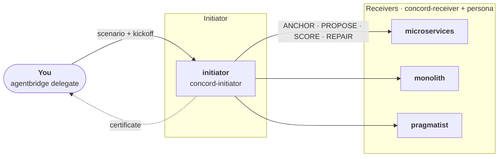

# Tutorial: CONCORD over AgentBridge

[AgentBridge](https://github.com/agntcy/shadi) (`agentbridge` and `shadictl`, from the
`agntcy/shadi` repository) registers each coding harness instance as a live agent and lets
one instance send a prompt to another with `agentbridge delegate`. Agents talk
[A2A](https://a2a-protocol.org), either natively or over a [SLIM](https://github.com/agntcy/slim)
message bus. It is used purely as process launcher and transport: the protocol is unchanged,
and the initiator uses `agentbridge delegate` as its delegation primitive, where an in-process
orchestrator would use its sub-agent tool.

The example below runs CONCORD across four independent Claude Code processes: one
initiator and three receivers with conflicting criteria (`microservices`, `monolith`,
`pragmatist`) that must agree on how to build a notification service. It uses the SLIM
transport; the node and identity steps are specific to it.



## Prerequisites

- Claude Code, with `ANTHROPIC_API_KEY`, `CLAUDE_CODE_OAUTH_TOKEN` or `ANTHROPIC_AUTH_TOKEN`
  set in the shell that registers the agents. The sandbox that wraps each agent cannot
  read your keychain login.
- `agentbridge` and `shadictl`, and `slimctl` for the SLIM node (SLIM transport only), on your `PATH`:

    ```bash
    brew tap agntcy/shadi https://github.com/agntcy/shadi.git
    brew install shadictl agentbridge
    ```

!!! warning "Unreleased fixes"
    Running several Claude Code instances side by side needs fixes that are not in an
    AgentBridge release yet, such as an explicit per-instance agent id and a fresh
    Claude session for every incoming message. Until they are released, build `agentbridge`
    and `shadictl` from the `agntcy/shadi` branches that carry them.

## One directory per agent

`claude` discovers skills and personas from its working directory, so each agent gets its own
directory. The skills come from [Getting the skills](../protocols/getting-started.md#getting-the-skills); the persona is a
`CLAUDE.md` that holds the criteria that agent rates candidates against.

```bash
for role in initiator microservices monolith pragmatist; do
  mkdir -p agents/$role/.claude/skills
done

SKILLS=~/repos/cognition-protocols/protocols/concord/skills
ln -s $SKILLS/concord-initiator agents/initiator/.claude/skills/
for role in microservices monolith pragmatist; do
  ln -s $SKILLS/concord-receiver agents/$role/.claude/skills/
done
```

Write each role's criteria in `agents/<role>/CLAUDE.md`. The initiator's `CLAUDE.md` should
tell it to keep every file it writes under `./run/`.

## Identity and profiles

AgentBridge authenticates members of the bus with DIDs, not shared secrets. Derive them for
all participants from one fixed seed with `shadictl derive-agent-identity`, and export
`SHADI_SLIM_AUTH=did`, `SLIM_HUMAN_SEED` and the comma-separated `SLIM_MEMBER_DIDS`.
Include these identities:

| Identity | Used for |
|---|---|
| `avatar` | You: the kickoff `agentbridge delegate` call from your terminal |
| `concord-driver` | The initiator's own outbound calls to the receivers (the bus allows one active session per identity, so it cannot reuse `avatar` or `initiator`) |
| `initiator`, `microservices`, `monolith`, `pragmatist` | The four registered agents |

Each role also needs an AgentBridge profile (`--tool <role>`) that launches `claude` in
print mode and sets the agent id. For the initiator, disallow the in-process `Task` tool so
that it can only delegate over the bus:

```json
{
  "id": "initiator",
  "bin": "claude",
  "execute": {
    "args": ["--print", "--output-format", "json",
             "--permission-mode", "bypassPermissions",
             "--disallowedTools", "Task",
             "--", "{prompt}"]
  }
}
```

Point `AGENTBRIDGE_PROFILES_DIR` at the directory holding these profiles. The full profiles,
with session handling and temp-directory pinning, are in the reference setup linked at the end of this section.

!!! note "Why the agents run sandboxed"
    With AgentBridge, agents are reached over the network: any member of the bus can send a
    prompt to an agent, and that prompt is acted on by a coding harness that can run commands
    and read and write files on your machine. An agent is therefore only as safe as the least
    trusted party that can message it. Each agent is launched under `shadictl`, which sandboxes
    the harness and restricts what it can do locally and what it can connect to:

    - **Filesystem:** the agent can write only to its own directory (plus the harness's own
      configuration and temp directories) and read only the skills it needs.
    - **Network:** outbound connections are blocked except for an explicit allow-list: the bus
      endpoint and the model API (`api.anthropic.com`).

    Bus membership is restricted in the same spirit: only the DIDs listed in `SLIM_MEMBER_DIDS`
    are admitted, and a protocol message can only trigger what the agent's own sandbox allows.

!!! warning "Sandboxing on macOS"
    On some macOS setups Claude Code cannot resolve hostnames under the sandbox, so its API calls
    fail. If that happens on a loopback-only bus, you can run `agentbridge register` without
    `shadictl`. Do not do this once the bus endpoint is reachable beyond `127.0.0.1`.

## Start the mesh

Use one terminal per process so that each agent's traffic is visible. Every terminal needs the
exported environment above.

```bash
# 1. the SLIM node (needs mTLS certificates)
slimctl slim start -c slim-node.yaml

# 2. the four agents, each from its own directory, inside the sandbox
cd agents/initiator && shadictl \
  --allow . --allow ~/.claude --allow ~/.claude.json \
  --read /path/to/protocols/concord/skills \
  --net-block --net-allow api.anthropic.com --net-allow 127.0.0.1:47560 \
  -- agentbridge register --tool initiator \
  --command "$PWD" --slim-endpoint 127.0.0.1:47560
# ... and the same in agents/microservices, agents/monolith, agents/pragmatist
```

Wait until every agent prints `ready — listening on ...`.

## Run the protocol

Hand the initiator its goal with `delegate`, as `avatar`. Give it the scenario **inline**:
a registered Claude Code instance cannot read files outside its own directory.

```bash
agentbridge delegate "$(cat kickoff.md)" \
  --to initiator --agent-id avatar --endpoint 127.0.0.1:47560
```

`kickoff.md` contains the scenario (the candidate schema and the anchors for the decision), and
tells the initiator to load `concord-initiator`, initialise it with
`--agents microservices,monolith,pragmatist`, and drive it to a certificate, reporting the
certificate verbatim. The initiator runs the skill's script itself. Every message the script
asks for is a real `agentbridge delegate` call to a live receiver, so a run takes minutes
rather than seconds: the call budget printed by `init` is `3N + (N+1)·B` (up to 41 calls at
`N=3` agents and `B=8` rounds).

The initiator's state file in `./run/` holds the authoritative certificate: `COMMIT` with
every agent at or above the satisfaction threshold, or `BEST_EFFORT` with the agent that
fell short.

!!! tip "Reference setup"
    The ready-made scripts for all of the above (certificate generation, one script per
    process, a one-command `demo.sh`, and recorded runs) are in the `concord/testing/agentbridge`
    folder of `ioc-core-l9`.
