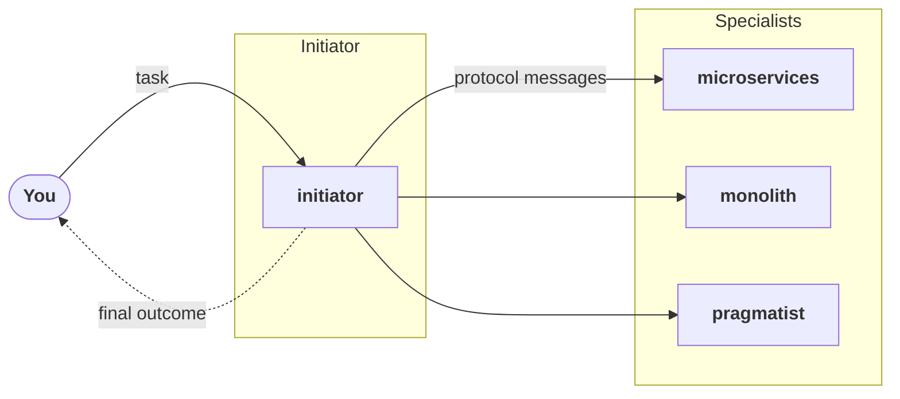

# Coding Agent Team

<p class="eyebrow">A team of coding agents settling an architecture decision</p>

A team of coding agents has to settle how to build a feature. Three specialists disagree, and
an initiator coordinates them with a Cognition Protocol. Run it with the
[AgentBridge tutorial](../../index.md).

## The task

> We are adding a new notification-delivery capability to the product (a notification
> service): users can opt in to email / push / SMS notifications for events raised across
> several existing subsystems. The team must develop it, and needs one decision on how to
> build it that everyone can live with.

## The agents

| Agent | Role |
|---|---|
| `initiator` | Starts the protocol and coordinates the specialists. It has no stake in the decision. |
| `microservices` | Advocates a standalone notifications service with its own datastore and deploy pipeline. |
| `monolith` | Advocates a notifications module inside the existing monolith. |
| `pragmatist` | Owns on-call load and infrastructure cost, with no architectural preference. |



The three specialists also use the words *service*, *deployment* and *outage* in different
senses, which is what a protocol has to bring to the surface before it can reconcile them.

## Role descriptions

Each description is a plain-text file you can download, or copy from the tab.

=== "microservices"

    [:material-download: Download](roles/microservices.txt){ download="microservices.txt" }

    ```markdown
    --8<-- "tutorials/agentbridge/examples/coding-agent-team/roles/microservices.txt"
    ```

=== "monolith"

    [:material-download: Download](roles/monolith.txt){ download="monolith.txt" }

    ```markdown
    --8<-- "tutorials/agentbridge/examples/coding-agent-team/roles/monolith.txt"
    ```

=== "pragmatist"

    [:material-download: Download](roles/pragmatist.txt){ download="pragmatist.txt" }

    ```markdown
    --8<-- "tutorials/agentbridge/examples/coding-agent-team/roles/pragmatist.txt"
    ```

## Using this example in the tutorial

The tutorial takes an example from its address. For this one, set:

```bash
SCENARIO=https://ioc-project.github.io/cognition-protocols/tutorials/agentbridge/examples/coding-agent-team
```

The files the tutorial downloads from it:

| File | Content |
|---|---|
| [`task.txt`](task.txt) | The task, as given above |
| `roles/<id>.txt` | The role description of each specialist, listed above |
| [`scenario.env`](scenario.env) | The specialists' ids and the identities of the agents |
