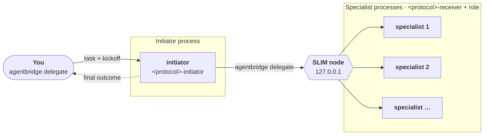

# Tutorial: running a protocol over AgentBridge

<p class="eyebrow">Agents on separate processes, joined by AgentBridge</p>

[AgentBridge](https://github.com/agntcy/shadi) ([`agentbridge`](https://github.com/agntcy/shadi/tree/main/crates/agentbridge_cli)
and [`shadictl`](https://github.com/agntcy/shadi/tree/main/crates/shadictl), from the
[`agntcy/shadi`](https://github.com/agntcy/shadi) repository) registers each coding harness instance as a live agent and lets
one instance send a prompt to another with `agentbridge delegate`. Agents talk
[A2A](https://a2a-protocol.org), either natively or over a [SLIM](https://github.com/agntcy/slim)
message bus. It is used purely as process launcher and transport: the protocol is unchanged,
and the initiator uses `agentbridge delegate` as its delegation primitive, where an in-process
orchestrator would use its sub-agent tool.

Any Cognition Protocol can run this way, on any team of agents. The tutorial describes the steps
to run one: independent coding-harness processes, one initiator and one per specialist. It uses
the SLIM transport; the certificate and identity steps are specific to it. The
[examples](examples/index.md) are complete implementations with the real commands and prompts.



!!! note "Local setup"
    The agents could run on different systems, each reaching the others over the network. To keep
    this tutorial simple, everything runs on one machine, and the SLIM node listens on the
    loopback address `127.0.0.1`.

## 1. Prerequisites

- A coding harness for each agent, with its credentials. AgentBridge can run Claude Code, Codex,
  Copilot, Cursor Agent, Goose and opencode, and agents of one team can use different harnesses.
- `agentbridge` and `shadictl` from [`agntcy/shadi`](https://github.com/agntcy/shadi), on your `PATH`. On macOS:

    ```bash
    brew tap agntcy/shadi https://github.com/agntcy/shadi.git
    brew install shadictl agentbridge
    ```

!!! note "Other operating systems"
    The commands above are for macOS. On another system, follow the installation instructions
    in the [`agntcy/shadi`](https://github.com/agntcy/shadi) repository instead.

## 2. Create your agents

A run needs a task, a team of specialists, and a role for each of them, plus the initiator that
starts the protocol. Each agent has its own directory, and three things in it: a harness, the
protocol's skills, and an instruction file.

```text
agents/
├── initiator/
│   ├── <instruction file>       # working rules
│   └── <skills folder>          # the protocol's skills
├── <specialist id>/
│   ├── <instruction file>       # the role of the specialist
│   └── <skills folder>
└── ...
```

### Pick a harness

Pick one for each agent. The harness is the program AgentBridge launches whenever the agent
receives a message.

### Install the protocol's skills

The harness discovers skills from its project directory, so install the protocol there, in each
agent, as described in [Installing a skill](../../getting-started.md#installing-a-skill). With
Claude Code, install the plugin in the agent's directory with project scope:

```bash
claude plugin marketplace add ioc-project/cognition-protocols
cd agents/<agent id> && claude plugin install <protocol>@cognition-protocols --scope project
```

Each agent gets both the initiator and the receiver skill. Their activation conditions are
precise, so the initiator skill only activates on the agent that starts the protocol and the
receiver skill on the agents that receive its messages.

### Define the instruction file

The harness reads the agent's role from the instruction file of its project directory:

| Harness | Instruction file |
|---|---|
| Claude Code | `CLAUDE.md` |
| Codex, opencode | `AGENTS.md` |
| Others | `AGENTS.md`, or the file the harness documents for project instructions |

For a specialist, the file is its role: what it cares about, and what it will and will not
accept. A specialist without a position has nothing to contribute to a decision. For the
initiator, the file only sets working rules, such as where to write its files and to report the
protocol's final output verbatim.

## 3. Create the AgentBridge profiles

AgentBridge launches an agent from a profile: the program to run, how to pass it a prompt, and
the id of the agent. Every agent needs its own profile, named after its id, and registered with
`--tool <agent id>`. AgentBridge bundles one profile per harness. Yours is the bundled profile of
your harness with its `id` changed:

```bash
mkdir -p profiles
curl -fsSL https://raw.githubusercontent.com/agntcy/shadi/main/crates/agentbridge/profiles/<harness>.json \
  | sed 's/"id": "<harness>"/"id": "<agent id>"/' > profiles/<agent id>.json
```

The bundled profiles are in the
[AgentBridge repository](https://github.com/agntcy/shadi/tree/main/crates/agentbridge/profiles).
Edit the `execute` arguments if the agent needs different flags, for example to run without
asking for approvals, since nobody is there to answer. Point `AGENTBRIDGE_PROFILES_DIR` at the
`profiles` directory.

## 4. Generate the certificates

The SLIM node and every agent authenticate each other with mutual TLS. AgentBridge refuses to
connect without it, even on the loopback address. The `agntcy/shadi` repository has a script
that generates a local certificate authority, a server certificate for the node and a client
certificate for your own terminal:

```bash
curl -fsSL https://raw.githubusercontent.com/agntcy/shadi/main/tools/generate_slim_mtls_certs.sh \
  -o generate_slim_mtls_certs.sh
bash generate_slim_mtls_certs.sh "$PWD/.tmp/shadi-slim-mtls"
```

The node itself needs no installation or configuration file: `shadictl slim start-node` runs a
native SLIM node.

## 5. Define the identities

AgentBridge authenticates members of the bus with DIDs. Each participant has one, derived
deterministically from a fixed seed and the participant's name:

| Identity | Used for |
|---|---|
| `avatar` | You: the `agentbridge delegate` call from your terminal that starts the run |
| `driver` | The initiator's own outbound calls to the specialists (the bus allows one active session per identity, so it cannot reuse `avatar` or `initiator`) |
| `initiator` and the specialists | The registered agents |

Derive them one at a time with `shadictl derive-agent-identity`, and export what every agent and
your terminal need:

```bash
export SHADI_SLIM_AUTH=did
export SLIM_HUMAN_SEED=<a fixed seed>
export SLIM_MEMBER_DIDS=<the DIDs of all participants, comma-separated>

export SLIM_ENDPOINT=127.0.0.1:47560
export SHADI_TMP_DIR="$PWD/.tmp"       # where AgentBridge looks for the certificates
export SLIM_TLS_CERT="$PWD/.tmp/shadi-slim-mtls/client-avatar.crt"
export SLIM_TLS_KEY="$PWD/.tmp/shadi-slim-mtls/client-avatar.key"

shadictl derive-agent-identity --source seed --in <seed file> -n <participant>   # prints its DID
```

On macOS, deriving an identity also stores its keys in the keychain, so derive them once, one
at a time, and keep the list. An example can publish the identities of its team, which skips this.

## 6. Register the agents

Start the SLIM node, then register each agent from its own directory. An agent is registered
with `agentbridge register`, wrapped in `shadictl`, which sandboxes the harness:

```bash
shadictl slim start-node                      # once, in its own terminal

shadictl <sandbox options> -- agentbridge register \
  --tool <agent id> --command "$PWD" --slim-endpoint "$SLIM_ENDPOINT"
```

Use one terminal per process so that each agent's traffic is visible, and export the credentials
of its harness first: the sandbox cannot read your keychain login. Wait until every agent prints
`ready — listening on ...`.

The sandbox options say what the agent can touch:

| Option | Grants |
|---|---|
| `--allow <dir>` | Read and write access: the agent's own directory, `.tmp` and the temp directories |
| `--read <dir>` | Read access: the profiles directory, and where the harness keeps its configuration and skills |
| `--net-block --net-allow <host>` | No network, except the bus endpoint and the harness's model API |

!!! note "Why the agents run sandboxed"
    With AgentBridge, agents are reached over the network: any member of the bus can send a
    prompt to an agent, and that prompt is acted on by a coding harness that can run commands
    and read and write files on your machine. An agent is therefore only as safe as the least
    trusted party that can message it. Each agent is launched under `shadictl`, which sandboxes
    the harness and restricts what it can do locally and what it can connect to:

    - **Filesystem:** the agent can write only to its own directory (plus the harness's own
      configuration and temp directories) and read only the files it needs.
    - **Network:** outbound connections are blocked except for an explicit allow-list: the bus
      endpoint and the model API of the harness.

    Bus membership is restricted in the same spirit: only the DIDs listed in `SLIM_MEMBER_DIDS`
    are admitted, and a protocol message can only trigger what the agent's own sandbox allows.

## 7. Prompt the initiator

Give the initiator its prompt **inline**: a registered agent cannot read files outside its own
directory. The prompt is a template with the task, the protocol to use, and how to reach the
specialists. The roles are not in it: each specialist already has its own, in its directory.
Replace what is in angle brackets, and save it as `prompt.md`.

```text
You coordinate a team of specialists (agent ids: <SPECIALIST IDS, COMMA-SEPARATED>). You cannot
read files outside this directory; everything you need is below. Put every file you write in
./run/.

TASK FOR THE TEAM: "<TASK>"

Load the <PROTOCOL>-initiator skill and follow it to the end. Reach each specialist with
'agentbridge delegate "<message>" --to <agent id> --agent-id driver --endpoint 127.0.0.1:47560'.
Never write a specialist's reply yourself. Report the skill's final output verbatim.
```

Then hand it to the initiator with `delegate`, as `avatar`, from another terminal:

```bash
agentbridge delegate "$(cat prompt.md)" \
  --to initiator --agent-id avatar --endpoint "$SLIM_ENDPOINT"
```

The initiator runs the skill's script itself. Every message the script asks for is a real
`agentbridge delegate` call to a live specialist, so a run takes minutes rather than seconds. The
protocol's own call budget, where it declares one, is printed when the initiator starts the run.
The initiator's state file in `./run/` holds the authoritative record of the run, in the
format defined by the protocol.

## 8. Look at the examples

The [examples](examples/index.md) are complete implementations with the real commands, role files
and prompts. Use them as inspiration for adapting the steps to your own use case:

- [Coding Agent Team](examples/coding-agent-team/index.md): three Claude Code specialists that
  must decide how to build a notification service.
