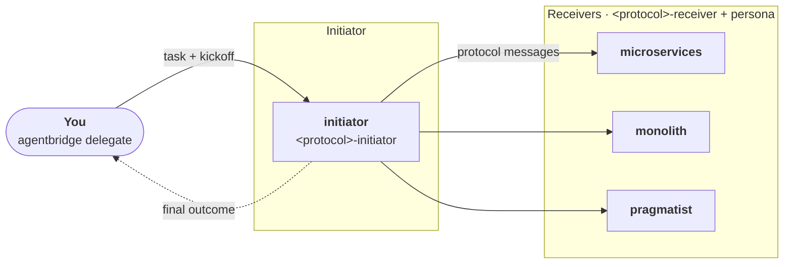

# Tutorial: running a protocol over AgentBridge

<p class="eyebrow">Agents on separate processes, joined by AgentBridge</p>

[AgentBridge](https://github.com/agntcy/shadi) ([`agentbridge`](https://github.com/agntcy/shadi/tree/main/crates/agentbridge_cli)
and [`shadictl`](https://github.com/agntcy/shadi/tree/main/crates/shadictl), from the
[`agntcy/shadi`](https://github.com/agntcy/shadi) repository) registers each coding harness instance as a live agent and lets
one instance send a prompt to another with `agentbridge delegate`. Agents talk
[A2A](https://a2a-protocol.org), either natively or over a [SLIM](https://github.com/agntcy/slim)
message bus. It is used purely as process launcher and transport: the protocol is unchanged,
and the initiator uses `agentbridge delegate` as its delegation primitive, where an in-process
orchestrator would use its sub-agent tool.

Any Cognition Protocol can run this way. The example below uses four independent Claude Code
processes: one initiator and three receivers with different roles (`microservices`, `monolith`,
`pragmatist`) that must reach a decision on how to build a notification service. It uses the
SLIM transport; the node and identity steps are specific to it.



!!! note "Local setup"
    The agents could run on different systems, each reaching the others over the network. To keep
    this tutorial simple, everything runs on one machine, and the SLIM node listens on the
    loopback address `127.0.0.1`.

## Prerequisites

- Claude Code, with `ANTHROPIC_API_KEY`, `CLAUDE_CODE_OAUTH_TOKEN` or `ANTHROPIC_AUTH_TOKEN`
  set in the shell that registers the agents. The sandbox that wraps each agent cannot
  read your keychain login.
- `agentbridge` and `shadictl` from [`agntcy/shadi`](https://github.com/agntcy/shadi), on your `PATH`. On macOS:

    ```bash
    brew tap agntcy/shadi https://github.com/agntcy/shadi.git
    brew install shadictl agentbridge
    ```

- `slimctl` from [`agntcy/slim`](https://github.com/agntcy/slim), which starts the SLIM node. On macOS:

    ```bash
    brew tap agntcy/slim https://github.com/agntcy/slim.git
    brew install slimctl
    ```

!!! note "Other operating systems"
    The commands above are for macOS. On another system, follow the installation instructions
    in each repository instead: [`agntcy/shadi`](https://github.com/agntcy/shadi) for
    `agentbridge` and `shadictl`, and [`agntcy/slim`](https://github.com/agntcy/slim)
    (see also the [SLIM documentation](https://docs.agntcy.org/slim/slim-howto/)) for `slimctl`.

## 1. Create the project directory

Everything below happens in one directory. Create it, with a directory per agent, one for the
AgentBridge profiles and one for the certificates of the SLIM node:

```bash
mkdir -p ~/coding-agent-team && cd ~/coding-agent-team
mkdir -p agents/{initiator,microservices,monolith,pragmatist} profiles certs .tmp
```

Run every command from this directory unless stated otherwise.

## 2. Install the protocol in each agent

Claude Code discovers skills and role files from its working directory, so each agent has its own
directory. Register the Cognition Protocols marketplace once, then install the protocol's plugin
in each agent's directory with project scope, so that it is enabled for that agent only:

```bash
claude plugin marketplace add ioc-project/cognition-protocols

PROTOCOL=concord   # or accord
for role in initiator microservices monolith pragmatist; do
  (cd agents/$role && claude plugin install $PROTOCOL@cognition-protocols --scope project)
done
```

Each plugin carries both the initiator and the receiver skill. Their activation conditions
are precise, so the initiator skill only activates on the agent that starts the protocol and
the receiver skill on the agents that receive its messages.

## 3. Write the role definitions

Each agent's `CLAUDE.md` holds its [role definition](index.md#role-descriptions). Download or copy the text
of each role from the [Coding Agent Team scenario](index.md#role-descriptions) as:

- `agents/initiator/CLAUDE.md`
- `agents/microservices/CLAUDE.md`
- `agents/monolith/CLAUDE.md`
- `agents/pragmatist/CLAUDE.md`

## 4. Create the AgentBridge profiles

Each role needs an AgentBridge profile (`--tool <role>`) that launches Claude Code in print mode
and sets the agent id. The four profiles differ only in their `id`, so generate them in a loop.
The in-process `Task` tool is disallowed, so that agents can only work with each other over the
network:

```bash
for role in initiator microservices monolith pragmatist; do
  cat > profiles/$role.json <<EOF
{
  "id": "$role",
  "bin": "claude",
  "pin_tmpdir": true,
  "env": {
    "TMPDIR": "{workdir}", "TMP": "{workdir}", "TEMP": "{workdir}",
    "CLAUDE_CODE_TMPDIR": "{workdir}", "CLAUDE_TMPDIR": "{workdir}"
  },
  "workdir_flags": ["--add-dir", "{workdir}"],
  "workdir_flags_on_execute": true,
  "workdir_flags_on_snapshot": true,
  "workdir_flags_on_inject": false,
  "current_dir_workdir": true,
  "system_flag": "--system-prompt",
  "split_large_prompt": false,
  "execute": {
    "args": ["--print", "--output-format", "json",
             "--permission-mode", "bypassPermissions",
             "--disallowedTools", "Task",
             "{workdir_flags}", "{system}", "{session}",
             "--", "{prompt}"]
  },
  "session": {
    "json_field": "session_id",
    "flag": "--session-id",
    "retry_stderr_contains": "already in use"
  },
  "result": { "kind": "json_field", "field": "result" }
}
EOF
done
```

## 5. Set up the SLIM node

The SLIM node authenticates every connection with mutual TLS. Generate a local certificate
authority, a server certificate for the node, and a client certificate for your own terminal:

```bash
cd certs
openssl req -x509 -newkey rsa:2048 -nodes -keyout ca.key -out ca.crt -days 365 \
  -subj "/CN=coding-agent-team CA"

printf 'basicConstraints=CA:FALSE\nkeyUsage=digitalSignature,keyEncipherment\nextendedKeyUsage=serverAuth\nsubjectAltName=DNS:localhost,IP:127.0.0.1\n' > server.ext
openssl req -newkey rsa:2048 -nodes -keyout server.key -out server.csr -subj "/CN=localhost"
openssl x509 -req -in server.csr -CA ca.crt -CAkey ca.key -CAcreateserial \
  -out server.crt -days 365 -extfile server.ext

printf 'basicConstraints=CA:FALSE\nkeyUsage=digitalSignature,keyEncipherment\nextendedKeyUsage=clientAuth\n' > client.ext
openssl req -newkey rsa:2048 -nodes -keyout client.key -out client.csr -subj "/CN=avatar"
openssl x509 -req -in client.csr -CA ca.crt -CAkey ca.key -CAcreateserial \
  -out client.crt -days 365 -extfile client.ext
cd ..
```

Then write the node configuration:

```bash
cat > slim-node.yaml <<EOF
tracing:
  log_level: debug

services:
  slim/0:
    dataplane:
      servers:
        - endpoint: "127.0.0.1:47560"
          tls:
            source:
              type: file
              cert: "$PWD/certs/server.crt"
              key: "$PWD/certs/server.key"
            include_system_ca_certs_pool: false
EOF
```

## 6. Define the identities and the environment

AgentBridge authenticates members of the bus with DIDs, not shared secrets. `env.sh` derives
one DID per participant from a fixed seed with `shadictl derive-agent-identity`, and exports
everything the agents and your terminal need. The participants are:

| Identity | Used for |
|---|---|
| `avatar` | You: the kickoff `agentbridge delegate` call from your terminal |
| `driver` | The initiator's own outbound calls to the receivers (the bus allows one active session per identity, so it cannot reuse `avatar` or `initiator`) |
| `initiator`, `microservices`, `monolith`, `pragmatist` | The four registered agents |

```bash
cat > env.sh <<'EOF'
# Source this from the project directory: source env.sh
export SLIM_ENDPOINT=127.0.0.1:47560
export AGENTBRIDGE_PROFILES_DIR="$PWD/profiles"
export SHADI_TMP_DIR="$PWD/.tmp"

export SLIM_TLS_CA="$PWD/certs/ca.crt"
export SLIM_TLS_CERT="$PWD/certs/client.crt"
export SLIM_TLS_KEY="$PWD/certs/client.key"

# DID authentication. The seed must be the same in every shell that sources this file.
export SHADI_SLIM_AUTH=did
export SLIM_HUMAN_SEED=coding-agent-team-seed
seed_file="$(mktemp "$PWD/.tmp/seed.XXXXXX")"
printf '%s' "$SLIM_HUMAN_SEED" > "$seed_file"
dids=""
for name in avatar driver initiator microservices monolith pragmatist; do
  did="$(shadictl derive-agent-identity --source seed --in "$seed_file" -n "$name" | awk '/^DID: /{print $2; exit}')"
  dids="${dids:+$dids,}$did"
done
rm -f "$seed_file"
export SLIM_MEMBER_DIDS="$dids"
EOF
```

Next, a script that registers one agent. It runs `agentbridge register` for a role under
`shadictl`, from the agent's own directory:

```bash
cat > register-agent.sh <<'EOF'
#!/usr/bin/env bash
# Usage: ./register-agent.sh <role>
set -euo pipefail
ROLE="${1:?usage: register-agent.sh <role>}"
ROOT="$(cd "$(dirname "$0")" && pwd)"
cd "$ROOT" && source ./env.sh
cd "agents/$ROLE"

shadictl \
  --allow . --allow ~/.claude --allow ~/.claude.json \
  --allow ~/.local/bin --allow ~/.local/share/claude \
  --allow "$ROOT/.tmp" --read "$ROOT/certs" --allow /tmp --allow /private/tmp \
  --net-block --net-allow api.anthropic.com --net-allow "$SLIM_ENDPOINT" \
  -- agentbridge register --tool "$ROLE" --command "$PWD" \
  --slim-endpoint "$SLIM_ENDPOINT"
EOF
chmod +x register-agent.sh
```

!!! note "Why the agents run sandboxed"
    With AgentBridge, agents are reached over the network: any member of the bus can send a
    prompt to an agent, and that prompt is acted on by a coding harness that can run commands
    and read and write files on your machine. An agent is therefore only as safe as the least
    trusted party that can message it. Each agent is launched under `shadictl`, which sandboxes
    the harness and restricts what it can do locally and what it can connect to:

    - **Filesystem:** the agent can write only to its own directory (plus the harness's own
      configuration and temp directories) and read only the files it needs.
    - **Network:** outbound connections are blocked except for an explicit allow-list: the bus
      endpoint and the model API (`api.anthropic.com`).

    Bus membership is restricted in the same spirit: only the DIDs listed in `SLIM_MEMBER_DIDS`
    are admitted, and a protocol message can only trigger what the agent's own sandbox allows.

!!! warning "Sandboxing on macOS"
    On some macOS setups Claude Code cannot resolve hostnames under the sandbox, so its API calls
    fail. If that happens on a loopback-only bus, you can remove the `shadictl` wrapper from
    `register-agent.sh` and run `agentbridge register` directly. Do not do this once the bus
    endpoint is reachable beyond `127.0.0.1`.

### Resulting layout

The project directory now looks like this:

```text
coding-agent-team/
├── env.sh                    # endpoint, certificates, DID identities
├── register-agent.sh         # registers one agent under the sandbox
├── slim-node.yaml            # SLIM node configuration
├── certs/                    # CA, server and client certificates
├── profiles/                 # AgentBridge profiles
│   ├── initiator.json
│   ├── microservices.json
│   ├── monolith.json
│   └── pragmatist.json
├── .tmp/                     # scratch space
└── agents/
    ├── initiator/
    │   ├── CLAUDE.md         # role definition
    │   ├── .claude/
    │   │   └── settings.json # enables the protocol plugin (project scope)
    │   └── run/              # created by the initiator during the run
    ├── microservices/
    │   ├── CLAUDE.md
    │   └── .claude/settings.json
    ├── monolith/
    │   ├── CLAUDE.md
    │   └── .claude/settings.json
    └── pragmatist/
        ├── CLAUDE.md
        └── .claude/settings.json
```

## 7. Start the mesh

Use one terminal per process so that each agent's traffic is visible. In each terminal, go to
the project directory first.

```bash
# terminal 1: the SLIM node
slimctl slim start -c slim-node.yaml

# terminals 2 to 5: one per agent
./register-agent.sh initiator
./register-agent.sh microservices
./register-agent.sh monolith
./register-agent.sh pragmatist
```

Wait until every agent prints `ready — listening on ...`.

## 8. Run the protocol

Write the kickoff message, in the shell where you set `PROTOCOL` and sourced `env.sh`. Give the initiator the task **inline**: a registered Claude Code
instance cannot read files outside its own directory. The task is the one on the
[Coding Agent Team scenario](index.md#the-task) page.

```bash
cat > kickoff.md <<EOF
You coordinate a team of three specialists (agent ids: microservices, monolith, pragmatist).
You cannot read files outside this directory; everything you need is below. Put every file
you write in ./run/.

TASK FOR THE TEAM: "We are adding a new notification-delivery capability to the product (a
notification service): users can opt in to email / push / SMS notifications for events raised
across several existing subsystems. Your team must develop it, and the team needs one decision
on how to build it that everyone can live with."

Load the $PROTOCOL-initiator skill and follow it to the end. Reach each specialist with
'agentbridge delegate "<message>" --to <agent id> --agent-id driver --endpoint $SLIM_ENDPOINT'.
Never write a specialist's reply yourself. Report the skill's final output verbatim.
EOF
```

Then hand it to the initiator with `delegate`, as `avatar`, from a sixth terminal:

```bash
source env.sh
agentbridge delegate "$(cat kickoff.md)" \
  --to initiator --agent-id avatar --endpoint "$SLIM_ENDPOINT"
```

The initiator runs the skill's script itself. Every message the script asks for is a real
`agentbridge delegate` call to a live receiver, so a run takes minutes rather than seconds. The
protocol's own call budget, where it declares one, is printed when the initiator starts the run.

The initiator's state file in `./run/` holds the authoritative record of the run, in the
format defined by the protocol.

!!! tip "Reference setup"
    The ready-made scripts for all of the above (certificate generation, one script per
    process, a one-command `demo.sh`, and recorded runs) are in the `concord/testing/agentbridge`
    folder of `ioc-core-l9`.
