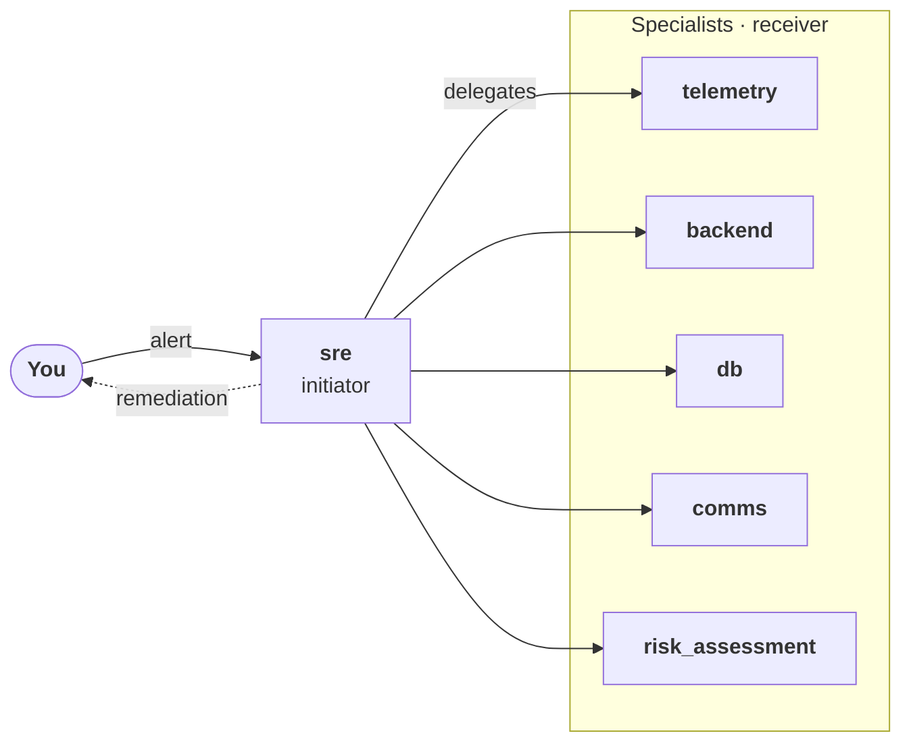

# SRE Triage

<p class="eyebrow">An on-call team triaging a production incident</p>

A payment service is failing in production and an on-call team of agents has to find the cause
and decide how to remediate it. The same incident runs in four ways: with no protocol, with ACCORD,
with CONCORD, and with both. Run it with the [MAS Lab tutorial](../../index.md).

The application and the lab come from the
[`ioc-eval-labs`](https://huggingface.co/datasets/ioc-project/ioc-eval-labs) dataset, which holds
the apps (`library-ioc-eval`) and the experiments (`labs/cognitive-protocols`). Nothing else has to
be cloned.

## The task

The dataset holds 27 incidents. The example runs `payment-async-timeout`:

> ALERT: triage critical payment-service incident: p99 latency spiked to 4200ms, error rate at
> 0.23, checkout flow impacted.
>
> Find the root cause and remediate the issue.

The expected remediation is to roll `payment-service` back to 3.7.1. The database connection pool is
elevated, but it is a symptom and not the root cause. The incident also holds an unrelated second
problem, a notification service whose heap is at 91.4%, which calls for a separate and minor restart.

## The agents

| Agent | Role |
|---|---|
| `sre` | The orchestrator. Receives the alert, delegates and decides. It is the initiator of the protocols. |
| `telemetry` | Metrics, logs and traces. |
| `backend` | Services and deployments. |
| `db` | The datastores. |
| `comms` | Status communication. |
| `risk_assessment` | Assesses the risk of the remediation. |



## The scenarios

The lab (`sre-triage-experiments.yaml`) declares one scenario per way to run the team. Each
scenario is the same application with a different set of overlays:

| Scenario | Overlays | What changes |
|---|---|---|
| `baseline` | `raise-context-window` | No protocol. |
| `accord-enabled` | `with-accord-protocol` | `sre` gets `accord-initiator`, the specialists get `accord-receiver`. |
| `concord-enabled` | `with-concord-protocol`, `-forced` | `sre` gets `concord-initiator`, the specialists get `concord-receiver`. The `-forced` overlay tells `sre` to run CONCORD for the remediation decision whatever the specialists say. |
| `concord-and-accord-enabled` | `with-accord-and-concord-protocol` | Both protocols. |

An overlay is a patch on the MAS manifest, so the application itself is shared by every scenario.
Enabling a protocol is what the [tutorial](../../index.md#3-define-the-agents) describes: listing the
protocol's skills in the `skills` of the agents. Here the overlay does it for each agent, and
`raise-context-window` lets `sre` keep the long protocol exchange in its context.

## Running it

The commands below carry out the steps of the [tutorial](../../index.md) for this example. The
agents (steps 3 and 4 of the tutorial) and the MAS manifest are already in the application, so
there is nothing to write. The application and the lab are taken at fixed commits, so a run can be
reproduced.

### 1. Prerequisites

You need `uv`, `git`, `curl` and `unzip`, and an OpenAI-compatible endpoint for the model, such as
a [LiteLLM](https://docs.litellm.ai/) proxy. Set these in the shell, and keep it open: every
command below runs in it.

```bash
export OPENAI_API_KEY=...                           # key for the endpoint
export OPENAI_BASE_URL=https://litellm.example/v1   # base URL of the endpoint
export LLM_MODEL_NAME=...                           # model name, as the endpoint knows it
```

### 2. Create the project directory

Create the directory, and check out MAS Lab and the dataset in it. The dataset also holds large
recorded runs, under `labs/cognitive-protocols/traces`, which are not needed to run the lab and are
left out:

```bash
mkdir -p ~/mas-lab-sre-triage && cd ~/mas-lab-sre-triage

MAS_LAB_COMMIT=0aeba4627437d49b9097dafbbf3e89ce9bb303ff
LAB_COMMIT=1208a077c7c682f8e484127f298ea52f8fe8e63a

git clone --quiet https://github.com/outshift-open/mas-lab
git -C mas-lab checkout --quiet $MAS_LAB_COMMIT

git init --quiet ioc-eval-labs
git -C ioc-eval-labs remote add origin https://huggingface.co/datasets/ioc-project/ioc-eval-labs
git -C ioc-eval-labs sparse-checkout set --no-cone '/*' '!labs/cognitive-protocols/traces'
GIT_LFS_SKIP_SMUDGE=1 git -C ioc-eval-labs fetch --quiet --depth 1 origin $LAB_COMMIT
GIT_LFS_SKIP_SMUDGE=1 git -C ioc-eval-labs checkout --quiet FETCH_HEAD
```

### 3. Install the protocol skills

The overlays of the lab name the skills, and MAS Lab finds them in the `skills/` directory of the
app. Download the four skills from the
[releases](https://github.com/ioc-project/cognition-protocols/releases) and copy them there, as in
the [tutorial](../../index.md#2-install-the-protocol-skills):

```bash
SKILLS_DIR=$PWD/ioc-eval-labs/library-ioc-eval/apps/sre-triage/v2/skills
RELEASES=https://github.com/ioc-project/cognition-protocols/releases/download
VERSION=0.1.0   # the version of each skill, as on the releases page

TMP=$(mktemp -d)
for SKILL in accord-initiator accord-receiver concord-initiator concord-receiver; do
  curl -fsSL $RELEASES/${SKILL}-v${VERSION}/${SKILL}.zip -o $TMP/${SKILL}.zip
  unzip -q -o $TMP/${SKILL}.zip -d $TMP
  cp -R $TMP/protocols/*/skills/${SKILL} $SKILLS_DIR/
done
```

### 4. Install MAS Lab and the app library

Install MAS Lab and the library of the dataset, which holds the application, in a virtual
environment:

```bash
uv venv --quiet --python 3.12 .venv
source .venv/bin/activate
uv pip install --quiet -e mas-lab
uv pip install --quiet -e ioc-eval-labs/library-ioc-eval
```

### 5. Point MAS Lab at the model

MAS Lab reads the endpoint from an infra manifest listed in its configuration. Write them in the
project directory, so your own MAS Lab configuration is left alone:

```bash
export XDG_CONFIG_HOME=$PWD/config
mkdir -p $XDG_CONFIG_HOME/mas

cat > $XDG_CONFIG_HOME/mas/config.yaml <<EOF
infra_refs:
  - llm-proxy.yaml
EOF

cat > $XDG_CONFIG_HOME/mas/llm-proxy.yaml <<EOF
apiVersion: infra/v1
kind: LLMProxy
metadata:
  name: llm-proxy
spec:
  proxy:
    api_base: env:OPENAI_BASE_URL
    api_key_env: OPENAI_API_KEY
    timeout: 240
  models:
    mappings:
      generic-model: ${LLM_MODEL_NAME}
    defaults:
      llm: ${LLM_MODEL_NAME}
EOF

export LLM_BASE_MODEL_URL=$OPENAI_BASE_URL LLM_API_KEY=$OPENAI_API_KEY
```

### 6. Run the lab

Run each scenario of the lab on the incident, from the directory of the lab:

```bash
cd ioc-eval-labs/labs/cognitive-protocols

for SCENARIO in baseline accord-enabled concord-enabled concord-and-accord-enabled; do
  mas-lab benchmark run sre-triage-experiments.yaml \
    --scenario-id $SCENARIO \
    --dataset-item payment-async-timeout \
    --max-runs 1 \
    --override 'experiment:experiment.execution.design.mode=cartesian' \
    --output-dir ~/mas-lab-sre-triage/results/$SCENARIO \
    --force
done
```

`--scenario-id` and `--dataset-item` choose what to run, and `--max-runs` the number of runs of each
pair. Any of the 27 incidents of the dataset can replace `payment-async-timeout`, and the scenarios
can be run one at a time. The override is needed because the lab couples the `concord-enabled`
scenario to `payment-async-timeout` alone, so any other pair would run nothing.

Each run calls the model live, for every agent and every message of the protocol, so it takes time
and costs tokens, more for the scenarios with a protocol than for the baseline.

### The results

Each scenario writes its `results.csv` under `mas-lab-sre-triage/results/<scenario>/`. In it,
`output` is an excerpt of the final answer of `sre`. The whole run, with the messages of every
agent, is the trace that `trace_path` points to, under `~/.cache/mas/traces`.

On `claude-haiku-4-5`, a baseline run took about 2 minutes and a run with a protocol 5 to 6
minutes. The answer of the team varies from run to run, with or without a protocol, so use several
runs (`--max-runs`) to compare scenarios.

The dataset also holds recorded runs of the labs, under `labs/cognitive-protocols/traces`, to
compare yours with.
