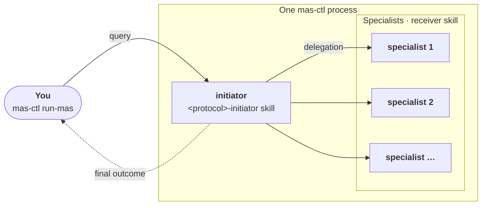

# Tutorial: running a protocol with MAS Lab

<p class="eyebrow">Agents defined as YAML manifests, run with mas-ctl</p>

[MAS Lab](https://outshift-open.github.io/mas-lab/) (`mas-lab`, `mas-ctl`) lets you define a
multi-agent system as a set of YAML manifests and run it with one command. The initiator and
its specialists are `kind: Agent` manifests that declare their role and skills. A `kind: MAS`
manifest wires them together. The initiator carries the protocol's initiator skill; the
specialists carry the receiver skill. The protocol is unchanged.



## Prerequisites

- **MAS Lab installed.** Follow [Tutorial 0 — Environment Setup](https://outshift-open.github.io/mas-lab/tutorials/00-environment-setup/)
  in the MAS Lab documentation to install `mas-ctl` and configure LLM access.

    ```bash
    uv venv .venv
    uv pip install mas-lab
    source .venv/bin/activate
    mas-lab init     # configure LLM access once
    ```

    !!! note "Other installation paths"
        Docker and developer-workspace installs also work. See [Tutorial 0](https://outshift-open.github.io/mas-lab/tutorials/00-environment-setup/) for those paths. Prefix every `mas-ctl` command with `docker compose --profile tools run --rm --no-deps cli` when using Docker.

## 1. Create the project directory

Create an empty directory for the MAS:

```bash
mkdir -p ~/mas-lab-run && cd ~/mas-lab-run
```

Run every command from this directory.

## 2. Install the protocol skills

MAS Lab discovers skills by name from the `skills/` directory next to the manifests. The
protocol skills follow the [agentskills.io](https://agentskills.io/) format: each skill is a
directory with a `SKILL.md` file. Download the skill zips from the
[GitHub releases page](https://github.com/ioc-project/cognition-protocols/releases) and
unzip them into `skills/`:

```bash
PROTOCOL=concord   # or accord
RELEASE=https://github.com/ioc-project/cognition-protocols/releases/latest/download

mkdir -p skills /tmp/cp-skills
for SKILL in ${PROTOCOL}-initiator ${PROTOCOL}-receiver; do
  curl -fsSL $RELEASE/${SKILL}.zip -o /tmp/cp-skills/${SKILL}.zip
  unzip -q /tmp/cp-skills/${SKILL}.zip -d /tmp/cp-skills/
  mv /tmp/cp-skills/${SKILL} skills/
done
```

The `skills/` directory should now contain:

```text
skills/
├── concord-initiator/
│   └── SKILL.md
└── concord-receiver/
    └── SKILL.md
```

## 3. Define the MAS

A MAS consists of:

- One `kind: Agent` manifest per agent, under `agents/`
- One `kind: MAS` manifest (`mas.yaml`) that wires them together

### Agent manifests

Each specialist is a `kind: Agent` manifest with its role description and the protocol's
receiver skill. Create one per specialist:

```yaml
# agents/<specialist-id>/agent.yaml
apiVersion: mas/v1
kind: Agent
metadata:
  name: <specialist-id>
spec:
  description: >
    <one-line description of this specialist's role>
  skills:
    - concord-receiver   # or accord-receiver
  context:
    role: |
      <the specialist's full role description>
```

The initiator agent carries the initiator skill and a role that tells it to run the protocol:

```bash
source scenario.env    # defines SPECIALISTS and PROTOCOL
NAMES="$(echo $SPECIALISTS | sed 's/ /, /g')"

mkdir -p agents/initiator
cat > agents/initiator/agent.yaml <<EOF
apiVersion: mas/v1
kind: Agent
metadata:
  name: initiator
spec:
  description: >
    Coordinates a team of specialists through a Cognition Protocol.
  skills:
    - ${PROTOCOL}-initiator
  context:
    role: |
      You coordinate a team of specialists (agent ids: $NAMES). Put every file
      you write in ./run/. Use the ${PROTOCOL}-initiator skill and follow it to
      the end, with --state ./run/<name>.json on every call of its script.
      The specialists are named exactly $NAMES.
EOF
```

### MAS manifest

The MAS manifest declares all agents and the workflow: the initiator runs first and can
delegate to any specialist.

```bash
AGENTS_YAML="      - id: initiator
        ref: agents/initiator/agent.yaml"
for role in $(echo $SPECIALISTS); do
  AGENTS_YAML="$AGENTS_YAML
      - id: $role
        ref: agents/$role/agent.yaml"
done

NODES_YAML="      - id: initiator
        delegates_to:"
for role in $(echo $SPECIALISTS); do
  NODES_YAML="$NODES_YAML
          - $role"
done
for role in $(echo $SPECIALISTS); do
  NODES_YAML="$NODES_YAML
      - id: $role"
done

cat > mas.yaml <<EOF
apiVersion: mas/v1
kind: MAS
metadata:
  name: cognition-protocol-run
  version: 1.0.0
spec:
  agency:
    agents:
$AGENTS_YAML
  workflow:
    entry: initiator
    nodes:
$NODES_YAML
EOF
```

### Resulting layout

```text
mas-lab-run/
├── mas.yaml                  # the MAS manifest
├── skills/
│   ├── concord-initiator/    # installed in step 2
│   └── concord-receiver/
└── agents/
    ├── initiator/
    │   └── agent.yaml
    ├── <specialist-1>/
    │   └── agent.yaml
    └── <specialist-2>/
        └── agent.yaml
```

## 4. Validate the manifests

Check all manifests are well-formed before running them:

```bash
mas-ctl validate mas.yaml
```

You should see `OK` for the MAS and for each agent.

## 5. Run the protocol

Pass the task to the initiator as a query. The initiator loads the protocol skill, runs the
protocol, and delegates to the specialists at each step the protocol requires:

```bash
mas-ctl run-mas mas.yaml -q "<your task>"
```

The run prints each delegation as it happens. The initiator ends with the protocol's final
output. Its state file is in `run/`.
